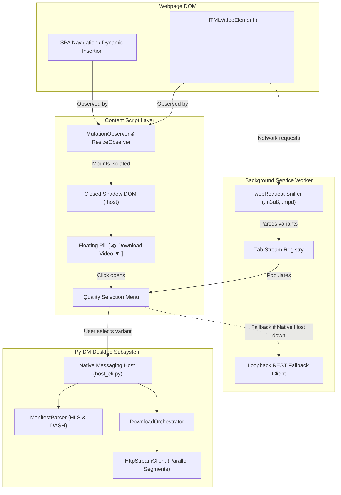

# PyIDM — Browser Video Detection & Floating Download Panel Guide

## Overview

PyIDM features an integrated **Browser Video Detection & Download Capture** system designed to reproduce and modernize the functionality of Internet Download Manager's (IDM) floating *"Download This Video"* panel.

When visiting a supported webpage with video players (e.g., YouTube, Vimeo, Twitch, news sites, or HTML5 `<video>` players), PyIDM automatically detects the media resources and displays an unobtrusive, floating control anchored directly near the video player. Clicking the control opens a quality selection menu displaying all available video renditions (1080p, 720p, 480p, audio-only) with container formats and estimated file sizes.

---

## 1. Supported Browsers

PyIDM provides cross-browser support across the major browser engines:

| Browser | Browser Engine | Manifest Standard | Communication Protocol |
|---|---|---|---|
| **Google Chrome** | Chromium (Blink/V8) | Manifest V3 | Native Messaging (`com.pyidm.native.host`) |
| **Microsoft Edge** | Chromium (Blink/V8) | Manifest V3 | Native Messaging (`com.pyidm.native.host`) |
| **Brave Browser** | Chromium (Blink/V8) | Manifest V3 | Native Messaging (`com.pyidm.native.host`) |
| **Opera** | Chromium (Blink/V8) | Manifest V3 | Native Messaging (`com.pyidm.native.host`) |
| **Mozilla Firefox** | Gecko (Spidermonkey) | Manifest V3 | Native Messaging (`com.pyidm.native.host`) |

> **Note**: If Native Messaging is temporarily unconfigured or unavailable, the extension automatically falls back to PyIDM's local loopback REST API (`http://127.0.0.1:8743/api/v1/downloads`) secured with SHA-256 tokens and anti-DNS rebinding checks.

---

## 2. Quick Setup & Browser Registration

### 2.1 Automated Registration (One Click)
You can register all installed browsers directly from PyIDM:
1. Open PyIDM.
2. Click **Settings** (or choose *Tools $\to$ Preferences*).
3. Switch to the **Browser Integration** tab.
4. Click **"Register All Browsers"**.
   - PyIDM automatically writes the necessary registry entries for Chrome, Edge, Brave, Opera, and Firefox.

### 2.2 Command-Line Registration
Alternatively, run the registration script directly from the project root:

```powershell
# Register all supported browsers
python browser_extensions/scripts/register_host.py

# Check current registration status
python browser_extensions/scripts/register_host.py --status

# Unregister all browsers
python browser_extensions/scripts/register_host.py --unregister
```

### 2.3 Installing the Browser Extension

#### For Chromium Browsers (Chrome, Edge, Brave, Opera):
1. Open your browser's extensions page:
   - Chrome / Brave: `chrome://extensions`
   - Edge: `edge://extensions`
   - Opera: `opera://extensions`
2. Enable **"Developer mode"** (toggle in upper right).
3. Click **"Load unpacked"**.
4. Select the folder:
   `PyIDM/browser_extensions/dist/chromium` (or `PyIDM/browser_extensions/chrome`).
5. The **PyIDM Integration** extension is now active.

#### For Mozilla Firefox:
1. Open Firefox and navigate to `about:debugging#/runtime/this-firefox`.
2. Click **"Load Temporary Add-on..."**.
3. Select the file:
   `PyIDM/browser_extensions/dist/firefox/manifest.json`.
4. The extension will be loaded and connected to PyIDM.

---

## 3. Architecture & Technical Design



### 3.1 Shadow DOM Encapsulation
The floating overlay is injected into a **closed `ShadowRoot`** (`host.attachShadow({ mode: "closed" })`). This design provides critical architectural advantages:
- **Zero Style Leakage**: Host page CSS rules (even broad resets like `* { box-sizing: border-box; font-family: ... }`) cannot alter or deform the floating pill.
- **Zero Page Impact**: PyIDM's styles do not leak into the parent document or disrupt existing video players.
- **Z-Index Layering**: Rendered at `z-index: 2147483647` (the maximum 32-bit signed integer) so the control remains accessible over custom player chrome and in native HTML5 fullscreen mode.

### 3.2 Dynamic Player Tracking & Single-Page Applications (SPAs)
- **`MutationObserver`**: Continuously monitors `document.documentElement` for newly mounted video elements. When dynamic players are created (such as navigating videos on YouTube, Twitter, or TikTok without full page reloads), the overlay attaches instantly.
- **`WeakMap` Registry**: Each `HTMLVideoElement` is mapped to its `PyIDMVideoOverlay` instance in a `WeakMap`. This eliminates duplicate overlays on the same video and ensures garbage collection when players are removed.
- **`ResizeObserver` & Viewport Tracking**: The overlay listens to window resize, scrolling, and element resize events, continuously recalculating coordinates via `getBoundingClientRect()` to maintain precise upper-right anchoring.

---

## 4. Media Stream Detection & Quality Extraction

PyIDM identifies and processes three distinct categories of media streams:

### 4.1 Progressive Media (.mp4, .webm, .mkv)
- Extracted directly from `video.currentSrc` or child `<source>` tags.
- Dispatched straight to PyIDM's multi-connection segmented download engine (`DownloadOrchestrator`).
- PyIDM inspects `Content-Length` and `Accept-Ranges: bytes` to partition the file into up to 32 concurrent byte-range connections.

### 4.2 HLS Master Playlists (RFC 8216)
- Intercepted by the background sniffer via `chrome.webRequest.onBeforeRequest` filtering `.m3u8` URLs.
- Parsed by `app/engine/media/manifest_parser.py`:
  - Reads `#EXT-X-STREAM-INF` tags.
  - Extracts resolutions ($1920\times1080$, $1280\times720$, etc.), peak bandwidth, and codecs.
  - Reads `#EXT-X-MEDIA:TYPE=AUDIO` groups for separate audio tracks.
  - Automatically sorts variants from highest resolution/bitrate to lowest.

### 4.3 DASH MPD Manifests (ISO/IEC 23009-1)
- Intercepted via `.mpd` network query patterns.
- Parsed via Python's standard `xml.etree.ElementTree`:
  - Parses `AdaptationSet[contentType="video"]` and `Representation` elements.
  - Identifies independent video tracks and audio streams.

### 4.4 DRM Content Handling
PyIDM respects legitimate digital rights management. Manifests containing proprietary encryption keys (`#EXT-X-KEY:METHOD=SAMPLE-AES`, FairPlay, or Widevine `ContentProtection` elements) are automatically flagged (`is_drm_protected=True`). PyIDM displays a clear notification that encrypted streams cannot be captured.

---

## 5. Security & Privacy Architecture

1. **Native Messaging Trust Boundary**:
   - The native host (`app/infrastructure/browser/native_host.py`) communicates exclusively over OS stdio pipes.
   - Operating system boundaries ensure regular untrusted web scripts have no direct execution vector to the native host executable.
2. **Loopback REST Hardening**:
   - The loopback API binds strictly to `127.0.0.1` (never `0.0.0.0`).
   - All incoming requests must supply the 256-bit secret token via the `X-PyIDM-Key` header verified with constant-time equality checks (`secrets.compare_digest`).
   - Anti-DNS rebinding logic drops any request where the `Host` header does not match `127.0.0.1:<port>` or `localhost:<port>`.
3. **Path Traversal & Filename Sanitization**:
   - Webpage titles and suggested filenames are sanitized by `FilenameResolver.sanitize()`.
   - Path separators (`/`, `\`), directory traversal symbols (`..`), and reserved Windows characters are stripped. Files are saved strictly in the designated download directory.
4. **Credential Redaction**:
   - Sensitive headers (`Authorization`, `Cookie`) used for authorized stream fetches are automatically redacted before session logs are written to disk.

---

## 6. Native Messaging Protocol Reference

All messages over standard I/O use the 4-byte native/little-endian binary length prefix framing:

$$\text{Frame} = [\text{uint32 length (4 bytes)}] + [\text{JSON string in UTF-8}]$$

### 6.1 `GET_STATUS` (Ping / Health Check)
**Sent by Extension:**
```json
{
  "type": "GET_STATUS",
  "request_id": "req-1"
}
```
**Response from PyIDM:**
```json
{
  "type": "STATUS_RESPONSE",
  "request_id": "req-1",
  "status": "ready",
  "app": "PyIDM",
  "version": "0.1.0",
  "active_downloads": 2
}
```

### 6.2 `ENQUEUE_MEDIA_DOWNLOAD` (Initiate Download)
**Sent by Extension:**
```json
{
  "type": "ENQUEUE_MEDIA_DOWNLOAD",
  "request_id": "req-2",
  "url": "https://example.com/video/sample.mp4",
  "title": "Wildlife Documentary",
  "container": "mp4",
  "quality": "1080p",
  "page_url": "https://example.com/watch?v=456",
  "headers": {
    "User-Agent": "Mozilla/5.0 ...",
    "Referer": "https://example.com/watch?v=456"
  }
}
```
**Response from PyIDM:**
```json
{
  "type": "DOWNLOAD_ACCEPTED",
  "request_id": "req-2",
  "download_id": "c1f7a4b0-95e2-4720-bc29-79f9446d3e18",
  "filename": "Wildlife Documentary.mp4",
  "status": "DOWNLOADING"
}
```

### 6.3 `PARSE_MANIFEST` (Extract Stream Variants)
**Sent by Extension:**
```json
{
  "type": "PARSE_MANIFEST",
  "request_id": "req-3",
  "url": "https://example.com/stream/master.m3u8",
  "content": "#EXTM3U\n#EXT-X-STREAM-INF:BANDWIDTH=5000000,RESOLUTION=1920x1080\n1080p.m3u8"
}
```
**Response from PyIDM:**
```json
{
  "type": "MANIFEST_VARIANTS",
  "request_id": "req-3",
  "url": "https://example.com/stream/master.m3u8",
  "variants": [
    {
      "id": "hls_0_1080p",
      "url": "https://example.com/stream/1080p.m3u8",
      "quality_label": "1080p",
      "container": "mp4",
      "resolution": "1920x1080",
      "bitrate_bps": 5000000,
      "display_title": "1080p • MP4 • 1920x1080 • 5000 kbps",
      "is_audio_only": false,
      "is_drm_protected": false
    }
  ]
}
```

---

## 7. Troubleshooting & Verification

### Checking Browser Connection
Run the status check:
```powershell
python browser_extensions/scripts/register_host.py --status
```
Expected output:
```text
PyIDM Native Messaging Registration Status:
  [CHROME]: REGISTERED
  [EDGE]: REGISTERED
  [BRAVE]: REGISTERED
  [OPERA]: REGISTERED
  [FIREFOX]: REGISTERED
```

### Inspecting Extension Logs
1. Navigate to your browser's extensions page (`chrome://extensions`).
2. Locate **PyIDM Integration** and click the **"service worker"** link (or inspect background script in Firefox).
3. The DevTools console will display captured media URLs and Native Messaging message exchanges in real time.

