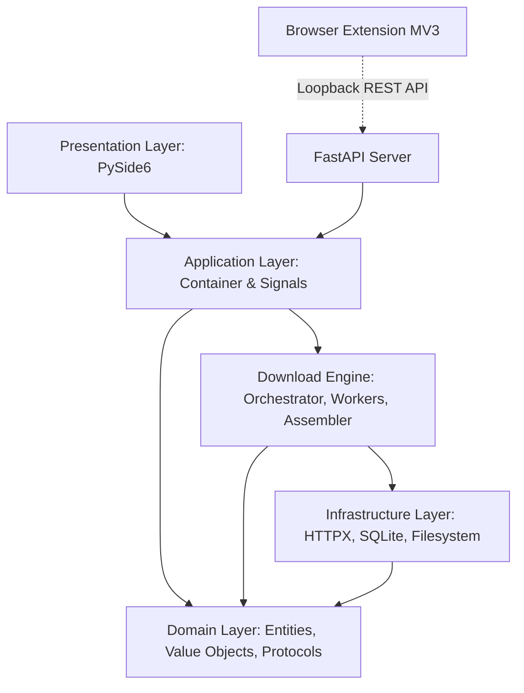
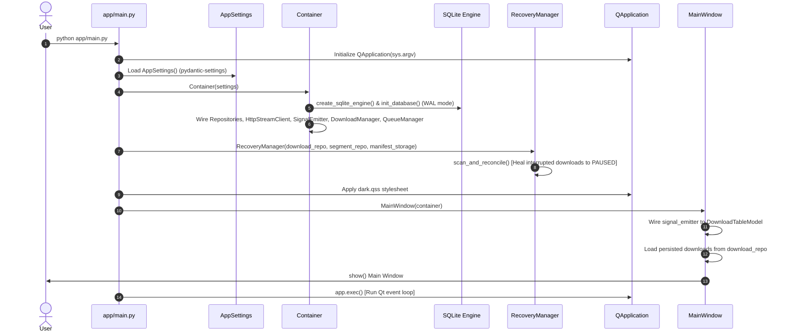

# Existing Codebase Discovery and Audit Report — PyIDM

**Document version:** 1.0  
**Status:** Complete — Stage 1 Discovery Gate  
**Date:** 2026-11-08  
**Author:** Software Architecture Team  
**Scope:** Exhaustive audit of repository structure, implemented code, engineering standards, verification baselines, reference UI comparison, and technical debt.

---

## 1. Repository Structure and Module Inventory

The repository is structured as a layered desktop application in Python. As of this audit, the codebase contains **72 source files** (comprising **1,833 executable statements** in the application core) plus test suites, browser extensions, packaging specifications, and planning documents.

```text
PyIDM/
├── app/                                        # Application source root
│   ├── __init__.py                             # Package root marker
│   ├── main.py                                 # Desktop entry point & bootstrap (47 lines)
│   ├── application/                            # Application coordination layer
│   │   ├── __init__.py
│   │   ├── container.py                        # Manual DI container (61 lines)
│   │   └── signals/
│   │       ├── __init__.py
│   │       └── download_signals.py             # Qt Signal bridge between threads & GUI (44 lines)
│   ├── domain/                                 # Pure business domain layer (zero external framework deps)
│   │   ├── downloads/
│   │   │   ├── entities/
│   │   │   │   ├── __init__.py
│   │   │   │   ├── download.py                 # Aggregate root `Download` (96 lines)
│   │   │   │   └── segment.py                  # `DownloadSegment` entity (58 lines)
│   │   │   ├── enums/
│   │   │   │   ├── __init__.py
│   │   │   │   ├── category.py                 # `DownloadCategory` enum
│   │   │   │   ├── download_status.py          # `DownloadStatus` 12-state enum
│   │   │   │   ├── failure_category.py         # `FailureCategory` taxonomy enum
│   │   │   │   ├── segment_status.py           # `SegmentStatus` enum
│   │   │   │   └── strategy.py                 # `DownloadStrategy` enum
│   │   │   ├── interfaces/
│   │   │   │   ├── __init__.py
│   │   │   │   ├── progress_reporter.py        # `ProgressReporter` protocol
│   │   │   │   └── repositories.py             # `DownloadRepository` & `SegmentRepository` protocols
│   │   │   ├── services/
│   │   │   │   ├── __init__.py
│   │   │   │   ├── category_classifier.py      # MIME & extension heuristics
│   │   │   │   ├── filename_resolver.py        # RFC 6266 parsing & deduplication
│   │   │   │   ├── segment_calculator.py       # Byte-range math & boundary partitioner
│   │   │   │   └── state_validator.py          # State machine transition matrix validator
│   │   │   └── value_objects/
│   │   │       ├── __init__.py
│   │   │       ├── byte_range.py               # `ByteRange` value object
│   │   │       ├── file_size.py                # `FileSize` formatting & arithmetic
│   │   │       ├── headers.py                  # `HttpHeaders` case-insensitive wrapper
│   │   │       ├── ids.py                      # Strongly typed IDs (`DownloadId`, `SegmentId`, `QueueId`)
│   │   │       ├── progress.py                 # `DownloadProgress` snapshot value object
│   │   │       ├── retry_policy.py             # `RetryPolicy` exponential backoff config
│   │   │       ├── speed.py                    # `DownloadSpeed` formatter
│   │   │       └── url.py                      # `DownloadUrl` parser & validator
│   │   └── exceptions/
│   │       ├── __init__.py
│   │       └── domain_errors.py                # Strongly typed domain exception hierarchy
│   ├── engine/                                 # Specialized download engine subsystem
│   │   ├── __init__.py
│   │   ├── assembly/
│   │   │   ├── __init__.py
│   │   │   └── file_assembler.py               # Sequential chunk binary assembly & size check (65 lines)
│   │   ├── downloader/
│   │   │   ├── __init__.py
│   │   │   └── orchestrator.py                 # `DownloadOrchestrator` lifecycle runner (266 lines)
│   │   ├── manager/
│   │   │   ├── __init__.py
│   │   │   ├── download_manager.py             # Concurrency manager & active worker tracker (126 lines)
│   │   │   └── queue_manager.py                # `QueueManager` & `DownloadQueue` priority scheduler (106 lines)
│   │   ├── monitoring/
│   │   │   ├── __init__.py
│   │   │   ├── progress_aggregator.py          # Throttled progress event aggregator (45 lines)
│   │   │   ├── speed_meter.py                  # Rolling window velocity calculator (46 lines)
│   │   │   └── token_bucket.py                 # Bandwidth throttling rate limiter (50 lines)
│   │   ├── recovery/
│   │   │   ├── __init__.py
│   │   │   └── recovery_manager.py             # Startup crash reconciler & manifest scanner (78 lines)
│   │   ├── retry/
│   │   │   ├── __init__.py
│   │   │   └── retry_coordinator.py            # Transient failure backoff & Retry-After parser (77 lines)
│   │   └── workers/
│   │       ├── __init__.py
│   │       ├── segment_worker.py               # Thread worker streaming HTTP byte ranges (75 lines)
│   │       └── worker_pool.py                  # Bounded `ThreadPoolExecutor` wrapper (29 lines)
│   ├── infrastructure/                         # External systems, I/O, persistence & networking
│   │   ├── __init__.py
│   │   ├── browser/
│   │   │   ├── __init__.py
│   │   │   └── server.py                       # Local FastAPI loopback server on 127.0.0.1:8743 (116 lines)
│   │   ├── configuration/
│   │   │   ├── __init__.py
│   │   │   └── app_settings.py                 # Pydantic Settings configuration (35 lines)
│   │   ├── filesystem/
│   │   │   ├── __init__.py
│   │   │   └── manifest_storage.py             # JSON manifest serializer/deserializer (73 lines)
│   │   ├── networking/
│   │   │   ├── __init__.py
│   │   │   ├── http_stream_client.py           # HTTPX streaming client & HEAD/GET inspector (118 lines)
│   │   │   └── response_metadata.py            # `ResponseMetadata` dataclass (24 lines)
│   │   ├── persistence/
│   │   │   ├── __init__.py
│   │   │   ├── database.py                     # SQLite engine factory & WAL pragma initializer (45 lines)
│   │   │   ├── mappers.py                      # Pure Domain <-> SQLAlchemy ORM bidirectional mappers (68 lines)
│   │   │   ├── models.py                       # SQLAlchemy 2.0 DeclarativeBase mapped models (74 lines)
│   │   │   └── repositories.py                 # Repository implementations (`SqlDownloadRepository`) (142 lines)
│   │   └── system/
│   │       ├── __init__.py
│   │       └── clipboard_monitor.py            # QClipboard watcher for valid HTTP/HTTPS URLs (60 lines)
│   ├── presentation/                           # Desktop GUI layer (PySide6 / Qt 6)
│   │   ├── __init__.py
│   │   ├── dialogs/
│   │   │   ├── __init__.py
│   │   │   └── add_download_dialog.py          # Add Download modal dialog (103 lines)
│   │   ├── models/
│   │   │   ├── __init__.py
│   │   │   └── download_table_model.py         # `QAbstractTableModel` for downloads table (124 lines)
│   │   ├── themes/
│   │   │   └── dark.qss                        # Dark theme Qt stylesheet (89 lines)
│   │   └── windows/
│   │       ├── __init__.py
│   │       └── main_window.py                  # Primary desktop window (184 lines)
│   └── shared/                                 # Cross-layer primitives & protocols
│       ├── __init__.py
│       ├── constants.py                        # System defaults, buffer sizes, timeouts (25 lines)
│       ├── protocols.py                        # Common protocols (28 lines)
│       └── types.py                            # Shared types & enums (Priority, etc.) (45 lines)
│
├── browser_extensions/                         # WebExtension manifests and service workers
│   └── chrome/
│       ├── manifest.json                       # Manifest V3 configuration (17 lines)
│       └── background.js                       # Service worker forwarding context menu URLs (40 lines)
│
├── packaging/
│   └── pyinstaller/
│       └── pyidm.spec                          # Desktop standalone packaging spec (72 lines)
│
├── pics/                                       # UI Reference images
│   ├── compact.jfif                            # Compact mode UI reference (Brisk-style layout)
│   ├── page.jfif                               # Modern dark mode full UI reference
│   └── page-1.jfif                             # Classic IDM 6.28 reference
│
├── tests/                                      # Test suite (24 automated tests, 79% statement coverage)
│   ├── __init__.py
│   ├── conftest.py                             # Pytest shared fixtures
│   ├── fixtures/
│   │   ├── __init__.py
│   │   └── mock_http_server.py                 # Local controllable HTTP server supporting ranges & error simulation
│   ├── gui/
│   │   └── test_main_window.py                 # Headless Qt tests via pytest-qt
│   ├── integration/
│   │   ├── test_browser_api.py                 # FastAPI loopback & token security tests
│   │   ├── test_lifecycle_and_queues.py        # Pause, resume, cancel, and queue priority dispatch tests
│   │   ├── test_networking.py                  # HTTP client range inspection & fallback tests
│   │   ├── test_persistence.py                 # SQLAlchemy 2.0 SQLite WAL repository tests
│   │   └── test_segmented_engine.py            # Multi-segment concurrent download & file assembly tests
│   └── unit/
│       ├── test_domain_models.py               # State machine, segment calculator, filename resolver unit tests
│       └── test_shared_types.py                # Value object & formatting unit tests
│
├── docs/                                       # Architectural specifications & planning deliverables
│   └── planning/                               # Complete Stage 1 design packages (01 through 14 + plan)
│
├── pyproject.toml                              # PEP 621 build & dependency configuration (uv/hatchling)
├── uv.lock                                     # Pinned dependency lockfile
├── .gitignore
├── .python-version                             # Python version pin (3.11)
└── README.md                                   # Project documentation and quickstart guide
```

---

## 2. Existing Architectural Overview

The codebase is organized into five distinct layers following Clean Architecture / Domain-Driven Design principles:



### Architectural Boundaries & Isolation
1. **Domain Layer (`app/domain/`)**: Pure business entities (`Download`, `DownloadSegment`), value objects (`ByteRange`, `DownloadUrl`, `HttpHeaders`), state machine validator, and protocols. **Zero imports of PySide6, HTTPX, or SQLAlchemy.**
2. **Engine Layer (`app/engine/`)**: Handles download execution. The `DownloadOrchestrator` controls range inspection, segmentation, worker execution, pause/cancel cooperatively via `threading.Event`, progress aggregation, retry management, and file assembly.
3. **Infrastructure Layer (`app/infrastructure/`)**: Concrete implementations of external concerns. `HttpStreamClient` wraps HTTPX; `SqlDownloadRepository` and `SqlSegmentRepository` wrap SQLAlchemy 2.0; `JsonManifestStorage` handles file-backed crash recovery; `LocalApiServer` embeds FastAPI for browser extensions; `ClipboardMonitor` wraps `QClipboard`.
4. **Application Layer (`app/application/`)**: Contains `Container` (constructor-injected dependency composition root) and `DownloadSignalEmitter` (translates non-blocking worker thread callbacks to Qt signals on the main GUI thread).
5. **Presentation Layer (`app/presentation/`)**: Contains PySide6 GUI components. `MainWindow` hosts `QTableView` driven by `DownloadTableModel`. Communication to the engine occurs exclusively through application services, and state updates flow via Qt signals.

---

## 3. Application Startup and Dependency Flow

Tracing execution from entry point `app/main.py`:



### Dependency Flow Analysis
- **Composition Root**: `Container` in `app/application/container.py` explicitly constructs and wires all dependencies via constructor injection. There is **no global service locator** or hidden mutable singleton.
- **Thread Model**: The Qt event loop runs on thread 0 (main thread). When a download starts, `DownloadManager.start_download()` spawns an orchestrator thread (`PyIDM-Orchestrator-{id}`), which spawns bounded worker threads in `WorkerPool` (`PyIDM-Worker-{id}-{seg}`). Progress updates are emitted via `DownloadSignalEmitter` which inherits from `QObject` and routes signals across thread boundaries into the Qt event queue.

---

## 4. Existing Class and Component Inventory

| Package | Class Name | Responsibility | Dependencies |
|---|---|---|---|
| `app.application` | `Container` | Central dependency injection container | `AppSettings`, `SqlDownloadRepository`, `HttpStreamClient`, `DownloadManager` |
| `app.application.signals` | `DownloadSignalEmitter` | Qt signal bridge from worker threads to GUI | `QObject`, `Signal`, `ProgressReporter` protocol |
| `app.domain.downloads.entities` | `Download` | Aggregate root representing a download task | `DownloadUrl`, `DownloadStatus`, `RetryPolicy`, `HttpHeaders` |
| `app.domain.downloads.entities` | `DownloadSegment` | Discrete byte-range slice within a segmented download | `ByteRange`, `SegmentStatus`, `DownloadId`, `SegmentId` |
| `app.domain.downloads.services` | `CategoryClassifier` | Classifies content based on MIME type and file extension | None |
| `app.domain.downloads.services` | `FilenameResolver` | RFC 6266 filename extraction and filesystem sanitization | `re`, `urllib.parse`, `Path` |
| `app.domain.downloads.services` | `SegmentCalculator` | Partitions total byte length into contiguous byte ranges | `ByteRange` |
| `app.domain.downloads.services` | `DownloadStateValidator` | Enforces valid transitions in the 12-state machine | `DownloadStatus`, `DomainError` |
| `app.engine.assembly` | `FileAssembler` | Sequentially stitches segment part files into the final destination | `pathlib.Path`, `DownloadSegment` |
| `app.engine.downloader` | `DownloadOrchestrator` | Coordinates inspection, segmentation, workers, assembly, and pause/cancel | `Download`, `HttpStreamClient`, `WorkerPool`, `ManifestStorage` |
| `app.engine.manager` | `DownloadManager` | Tracks active orchestrators, thread lifecycle, and concurrency limits | `DownloadRepository`, `SegmentRepository`, `TokenBucket` |
| `app.engine.manager` | `QueueManager` | Manages ordered queues, slot limits, and priority progression | `DownloadManager`, `DownloadRepository`, `DownloadQueue` |
| `app.engine.monitoring` | `ProgressAggregator` | Throttles high-frequency byte writes to 4 Hz progress notifications | `Download`, `ProgressReporter`, `DownloadSpeed` |
| `app.engine.monitoring` | `SpeedMeter` | Computes rolling average velocity over sliding time window | `time.monotonic` |
| `app.engine.monitoring` | `TokenBucket` | Rate limiter implementing token bucket algorithm | `threading.Lock`, `time.monotonic` |
| `app.engine.recovery` | `RecoveryManager` | Scans disk manifests and reconciles interrupted states on startup | `DownloadRepository`, `ManifestStorage` |
| `app.engine.retry` | `RetryCoordinator` | Handles exponential backoff with jitter and Retry-After header parsing | `RetryPolicy`, `threading.Event` |
| `app.engine.workers` | `SegmentWorker` | Streams HTTP byte range chunks into segment `.part` file | `HttpStreamClient`, `TokenBucket`, `threading.Event` |
| `app.engine.workers` | `WorkerPool` | Bounded `ThreadPoolExecutor` wrapper | `concurrent.futures.ThreadPoolExecutor` |
| `app.infrastructure.browser` | `LocalApiServer` | Background FastAPI/uvicorn server for browser integration | `FastAPI`, `uvicorn`, `Container` |
| `app.infrastructure.configuration` | `AppSettings` | Pydantic Settings reading environment variables & defaults | `pydantic_settings.BaseSettings` |
| `app.infrastructure.filesystem` | `JsonManifestStorage` | Manages `.pyidm_temp/<id>/manifest.json` on disk | `pathlib.Path`, `json` |
| `app.infrastructure.networking` | `HttpStreamClient` | HTTPX wrapper for HEAD/GET inspection and ranged chunk streaming | `httpx.Client` |
| `app.infrastructure.persistence` | `SqlDownloadRepository` | SQLAlchemy 2.0 repository persisting `Download` aggregates | `sessionmaker`, `DownloadModel` |
| `app.infrastructure.persistence` | `SqlSegmentRepository` | SQLAlchemy 2.0 repository persisting `DownloadSegment` entities | `sessionmaker`, `SegmentModel` |
| `app.infrastructure.system` | `ClipboardMonitor` | Qt system clipboard observer triggering on new URLs | `QClipboard`, `QGuiApplication` |
| `app.presentation.dialogs` | `AddDownloadDialog` | Modal dialog for entering URL, filename, path, and connections | `QDialog`, `FilenameResolver`, `DownloadUrl` |
| `app.presentation.models` | `DownloadTableModel` | `QAbstractTableModel` implementation for download rows | `QAbstractTableModel`, `Download`, `FileSize` |
| `app.presentation.windows` | `MainWindow` | Main PySide6 window hosting toolbar, table, and context menu | `QMainWindow`, `DownloadTableModel`, `Container` |

---

## 5. Existing Feature Inventory with Implementation Statuses

| Feature Category | Feature Description | Status | Evidence / Notes |
|---|---|---|---|
| **Networking** | HTTP GET streaming with bounded memory buffer (64 KB) | **Complete** | `app/infrastructure/networking/http_stream_client.py:65` (`iter_bytes`) |
| **Networking** | HTTP HEAD / ranged GET resource inspection | **Complete** | `app/infrastructure/networking/http_stream_client.py:27` (`inspect()`) |
| **Networking** | Range request support & 206 Partial Content validation | **Complete** | Tested against mock server in `test_networking.py` |
| **Networking** | Single-stream fallback for non-range servers | **Complete** | `app/engine/downloader/orchestrator.py:108` |
| **Networking** | Custom request headers & User-Agent | **Complete** | Handled in `HttpStreamClient` and `HttpHeaders` |
| **Engine** | Multi-connection parallel segmented downloading | **Complete** | Verified in `test_segmented_engine.py` (parallel segment workers) |
| **Engine** | Contiguous byte-range partitioning | **Complete** | `app/domain/downloads/services/segment_calculator.py` |
| **Engine** | Temporary segment file storage (`.pyidm_temp/`) | **Complete** | `app/infrastructure/filesystem/manifest_storage.py` |
| **Engine** | Atomic file assembly & integrity byte check | **Complete** | `app/engine/assembly/file_assembler.py:25` |
| **Engine** | Cooperative pause and resume | **Complete** | Tested in `test_lifecycle_and_queues.py` |
| **Engine** | Cancellation & temporary file cleanup | **Complete** | `orchestrator.py:73` and `manifest_storage.delete()` |
| **Engine** | Startup crash recovery via JSON manifests | **Complete** | `app/engine/recovery/recovery_manager.py:32` |
| **Engine** | Exponential backoff retry coordinator | **Partially implemented** | Retry logic exists in `retry_coordinator.py`, but automated retry loop inside `SegmentWorker` is unverified |
| **Engine** | Bandwidth rate limiter (Token Bucket) | **Partially implemented** | `TokenBucket` class exists and is instantiated, but global aggregate speed throttling is partially wired |
| **Queue & Scheduling**| Multi-queue priority progression | **Partially implemented** | `QueueManager` has `tick()` and priority ordering; background scheduler thread/timer is not yet started |
| **Persistence** | SQLite with WAL mode & foreign keys enabled | **Complete** | `app/infrastructure/persistence/database.py:23` |
| **Persistence** | SQLAlchemy 2.0 mapped models & repositories | **Complete** | Verified in `test_persistence.py` (CRUD operations) |
| **Browser Integration**| Embedded FastAPI loopback server (127.0.0.1:8743) | **Complete** | Verified in `test_browser_api.py` with API key & Host validation |
| **Browser Integration**| Chrome Manifest V3 extension | **Prototype** | `browser_extensions/chrome/` files exist; Firefox version not packaged |
| **Clipboard** | System clipboard monitoring for URLs | **Prototype** | `ClipboardMonitor` class exists, but not wired into `MainWindow` |
| **Desktop GUI** | PySide6 main window with table view | **Partially implemented** | Basic table and toolbar exist; missing navigation sidebar and compact mode |
| **Desktop GUI** | Add Download dialog | **Partially implemented** | Basic URL, path, filename, connections dialog exists; lacks advanced tabs |
| **Desktop GUI** | Segmented progress bar custom delegate | **Missing** | Current table shows plain text percentage `75.0%` rather than graphical bar |
| **Desktop GUI** | Dual UI mode (Expanded vs. Compact Mode) | **Missing** | Neither compact mode toggle nor compact layout are implemented |
| **Desktop GUI** | Left sidebar navigation (Categories, Queues) | **Missing** | Left sidebar shown in references is not present in `MainWindow` |
| **Desktop GUI** | Download Details dialog | **Missing** | No dialog showing segment stripes, resolved URLs, or error logs |
| **Desktop GUI** | Settings dialog | **Missing** | No UI dialog to adjust preferences, paths, or speed limits |
| **Desktop GUI** | Search and filtering | **Missing** | Search bar and status/category filters from references are missing |
| **Desktop GUI** | Tray icon and background minimize | **Missing** | No system tray icon implementation |
| **Packaging** | PyInstaller standalone packaging specification | **Prototype** | `packaging/pyinstaller/pyidm.spec` exists; Linux/macOS scripts missing |

---

## 6. Download Engine Capability Assessment

The core download engine in `app/engine/` is architecturally robust and well-conceived:
- **Streaming Pipeline**: Uses `httpx.Client.stream("GET", ...)` reading in fixed 64 KB chunks (`DEFAULT_CHUNK_SIZE`). Memory consumption is strictly $O(1)$ regardless of download size.
- **Worker Concurrency**: Uses `WorkerPool` wrapping `concurrent.futures.ThreadPoolExecutor`. Workers stream concurrently to independent `.part` files on disk.
- **Cooperative Signaling**: `threading.Event` objects (`cancel_event`, `pause_event`) are checked inside each chunk iteration loop. This prevents abrupt thread termination and guarantees flushed file descriptors.
- **Assembly Strategy**: `FileAssembler` appends `.part` files sequentially using buffered binary streams, verifies the resultant file size against `expected_total_size`, and raises `AssemblyError` upon mismatch.
- **Recovery Strategy**: `RecoveryManager` examines the SQLite database and disk manifests on application startup. Downloads left in `DOWNLOADING`, `PAUSING`, or `INSPECTING` states are safely reconciled to `PAUSED` without data loss, allowing immediate resumption.

---

## 7. GUI and UI Reference Comparison

We performed a detailed visual and architectural comparison of the existing PySide6 implementation against the three reference images:

### Reference 1: `page.jfif` (Modern Dark Full Interface)
- **Implemented Elements**:
  - Dark background palette (styled with `app/presentation/themes/dark.qss`).
  - Core download table showing File Name, Size, Progress, Speed, ETA, Status.
  - Basic toolbar actions: Add, Resume, Pause, Stop/Cancel, Delete.
  - Context menu with Resume, Pause, Open Folder, Open File.
- **Missing Elements**:
  - **Left Sidebar**: Missing sections for *Downloads* ("All Tasks (8)", "Downloading (3)", "Waiting", "Finished / Stopped (5)"), *Settings* ("General Settings", "Engine Settings", "Engine Status" badge), and *Support Author*.
  - **Header Controls**: Missing "+ New" primary button, Multi-select view toggle, Sort order selector (A-Z with arrow), Help button, **"Compact Mode" toggle switch**, and Search bar.
  - **Progress Visuals**: Missing graphical multi-segment progress bar with color-coded states (blue for active, green for completed, orange for paused/error).
  - **Batch Selection**: Missing checkboxes in table rows and multi-select context actions ("Select Failed Tasks", "Select Completed Tasks", "Select All").
  - **Details Expander**: Missing row-level chevron `>` to expand download details inline.
  - **Status Footer**: Missing bottom toolbar showing aggregate transfer rates ("↓ 0.00 B/s ↑ 0.00 B/s").

### Reference 2: `compact.jfif` (Modern Compact Dark Interface)
- **Implemented Elements**:
  - Dark mode color scheme.
  - Basic row actions (Download, Stop, Remove).
- **Missing Elements**:
  - **Compact Mode Window / View**: Completely absent. There is currently no compact mode toggle or layout.
  - **Vertical Slim Sidebar**: Missing icon-only sidebar (Downloads, Queues, Completed, Add, Settings gear).
  - **Compact Toolbar**: Missing compact action buttons ("Add URL", "Download", "Stop", "Remove", "Add To Queue", "Check for Update", "Get Extension").
  - **Compact Table Columns**: Missing "Transfer Rate", "Time Left", and "Start Date" formatted for high-density display.

### Reference 3: `page-1.jfif` (Classic IDM 6.28 Interface)
- **Implemented Elements**:
  - Download categorization backend (`DownloadCategory` enum and `CategoryClassifier`).
  - Basic tabular download management.
- **Missing Elements**:
  - Classic category tree navigation (All Downloads -> Compressed, Documents, Music, Programs, Video).
  - Queue hierarchy tree (Queues, Scheduler).
  - Main menu bar (Tasks, File, Downloads, View, Help, Options).

### Architectural Conclusion for UI
Both expanded and compact modes must share the **exact same underlying state**, `DownloadTableModel`, `Container`, and backend engine. A layout switcher or dual-view architecture in `MainWindow` can toggle between the Expanded Dashboard (`page.jfif` / `page-1.jfif` hybrid) and the Compact Dashboard (`compact.jfif`) seamlessly via the header toggle switch.

---

## 8. Browser Integration Assessment

- **Local API**: Implemented in `app/infrastructure/browser/server.py` using FastAPI and uvicorn.
- **Security Protections**:
  - **Loopback Binding**: Configured strictly on `127.0.0.1:8743`.
  - **Host Header Verification**: Enforces `Host: 127.0.0.1:8743` or `Host: localhost:8743` to protect against DNS rebinding attacks.
  - **Token Authentication**: Requires `X-PyIDM-Key` header verified with constant-time comparison (`secrets.compare_digest`).
  - **CORS Policy**: Restricts `allow_origin_regex` to browser extension schemes (`^(chrome-extension|moz-extension)://.*$`).
- **Browser Extension**: Manifest V3 extension present in `browser_extensions/chrome/`. It installs a context menu item ("Download with PyIDM") and forwards clicked links to the local API via `fetch()`. Firefox packaging and native messaging manifests are outstanding.

---

## 9. Persistence and Database Assessment

- **Database**: SQLite with Write-Ahead Logging (`PRAGMA journal_mode=WAL`) and foreign keys enabled (`PRAGMA foreign_keys=ON`).
- **ORM / Schema**: SQLAlchemy 2.0 DeclarativeBase models (`DownloadModel`, `SegmentModel`) mapped cleanly to pure domain entities (`Download`, `DownloadSegment`) via `app/infrastructure/persistence/mappers.py`.
- **Transactions**: Repository methods use explicit `sessionmaker` context managers ensuring atomic commits and rollbacks.
- **Migrations**: Alembic is listed as a dependency, but database creation is currently initialized directly via `metadata.create_all()`. Formal Alembic migration scripts should be introduced.

---

## 10. Testing and Verification Results

Baseline verification was executed on the host environment (Windows, Python 3.11.0):

1. **Pytest Test Suite**:
   ```powershell
   .\venv\Scripts\pytest.exe --cov=app --cov-report=term-missing
   ```
   **Result:** **24 passed, 0 failed** in 8.72 seconds. Overall test coverage across `app/` is **79%**.
   - `app/domain`: 90–100% coverage.
   - `app/engine`: 70–89% coverage.
   - `app/infrastructure`: 80–100% coverage.
   - `app/presentation`: 18–57% coverage (GUI requires expanded test automation).

2. **Static Type Checking (`mypy --strict`)**:
   ```powershell
   .\venv\Scripts\mypy.exe --explicit-package-bases app tests
   ```
   **Result:** **Success: no issues found in 72 source files.**

3. **Code Linting (`ruff check .`)**:
   ```powershell
   .\venv\Scripts\ruff.exe check .
   ```
   **Result:** **5 lint errors found** (all safe and autofixable):
   - `app/application/signals/download_signals.py:3:1`: Unsorted import block (`I001`).
   - `app/application/signals/download_signals.py:7:63`: Unused import `ProgressReporter` (`F401`).
   - `app/engine/downloader/orchestrator.py:150, 168, 243`: Use `datetime.UTC` alias instead of `datetime.timezone.utc` (`UP017`).

---

## 11. Type-Safety and Code-Quality Assessment

### Prohibition of `Any` Compliance
The codebase was audited for occurrences of `typing.Any`. Three violations were identified:
1. `app/presentation/models/download_table_model.py:5, 45, 54`:
   ```python
   def headerData(..., role: int = Qt.ItemDataRole.DisplayRole) -> Any: ...
   def data(..., role: int = Qt.ItemDataRole.DisplayRole) -> Any: ...
   ```
   *Remediation:* Replace `Any` with `object` or `QVariant` / `str | None` to eliminate dynamic typing.
2. `app/infrastructure/browser/server.py:8, 67`:
   ```python
   async def enqueue_download(payload: AddDownloadPayload) -> dict[str, Any]:
   ```
   *Remediation:* Replace `dict[str, Any]` with `dict[str, str]` or a dedicated Pydantic response DTO `EnqueueDownloadResponse`.
3. `tests/gui/test_main_window.py:44`:
   ```python
   def test_main_window_headless(qtbot, tmp_path: Path) -> None:  # type: ignore[no-untyped-def]
   ```
   *Remediation:* Import `pytestqt.qtbot.QtBot` and annotate `qtbot: QtBot` to remove the `# type: ignore` suppression.

---

## 12. Security and Reliability Assessment

- **Path Traversal Protection**: `FilenameResolver.sanitize()` strips illegal characters and directory traversal markers (`..`, `/`, `\`), preventing writes outside designated folders.
- **URL Scheme Validation**: `DownloadUrl.parse()` strictly enforces `http` or `https` schemes, preventing `file://`, `gopher://`, or loopback bypass tricks.
- **Local API Hardening**: Loopback interface binding, token authentication, Host header checks, and strict CORS rules safeguard the desktop from malicious browser scripts.
- **Resource Management**: Sockets and file handles are wrapped in Python context managers (`with client.stream(...)`, `with open(...)`). Temporary files are cleanly cleaned up on completion or cancellation.

---

## 13. Existing Defects and Technical Debt

1. **Ruff Formatting Violations**: 5 minor lint warnings in `download_signals.py` and `orchestrator.py`.
2. **`Any` Type Annotations**: Present in `download_table_model.py` and `server.py`.
3. **Queue Scheduler Disconnect**: `QueueManager` has queue sorting and `tick()` logic, but there is no standing background timer or event-driven dispatcher invoking `tick()` as downloads complete.
4. **Clipboard Monitor Inactive**: `ClipboardMonitor` is implemented but not instantiated or connected to the UI in `main.py` or `MainWindow`.
5. **GUI Presentation Gap**: The UI is currently a basic prototype missing the left navigation sidebar, compact mode layout, segmented progress bar delegate, settings window, details dialog, and search/sort bar shown in `page.jfif`, `compact.jfif`, and `page-1.jfif`.

---

## 14. Reusable Components and Implementations

The following components are well-engineered, thoroughly tested, and should be **preserved and reused directly**:
- `app/domain/downloads/entities/download.py` & `segment.py`
- `app/domain/downloads/services/segment_calculator.py`
- `app/domain/downloads/services/state_validator.py`
- `app/domain/downloads/services/filename_resolver.py`
- `app/domain/downloads/services/category_classifier.py`
- `app/domain/downloads/value_objects/*` (all value objects)
- `app/engine/downloader/orchestrator.py` (download lifecycle coordination)
- `app/engine/workers/segment_worker.py` (ranged HTTP streaming)
- `app/engine/assembly/file_assembler.py` (binary file assembly)
- `app/engine/recovery/recovery_manager.py` (manifest recovery)
- `app/infrastructure/networking/http_stream_client.py` (HTTPX client)
- `app/infrastructure/persistence/*` (database, models, repositories, mappers)
- `app/infrastructure/browser/server.py` (FastAPI local API)
- `tests/fixtures/mock_http_server.py` (HTTP test harness)

---

## 15. Missing Functionality

The following components must be implemented to fulfill the complete product vision and match the reference designs:
1. **Custom Item Delegate (`SegmentedProgressBarDelegate`)**: Custom painting of multi-segment progress bars in table cells with state-based color styling (blue active, green completed, orange paused/failed).
2. **Dual-Mode Desktop Interface (Expanded & Compact Modes)**:
   - **Expanded Mode** (`page.jfif` & `page-1.jfif`): Full sidebar navigation (Status filters, Category tree, Queues), top header with search, sort, and compact toggle.
   - **Compact Mode** (`compact.jfif`): Slim icon sidebar, compact top toolbar, high-density table view.
   - Seamless toggling between modes sharing the same `Container` and `DownloadTableModel`.
3. **Download Details Dialog (`DownloadDetailsDialog`)**: Tabbed dialog displaying segment stripes, byte offsets, worker thread status, resolved URLs, and network logs.
4. **Settings Dialog (`SettingsDialog`)**: Configuration for directories, connection limits, speed limits, clipboard toggle, browser API port, and theme selection.
5. **Background Queue Dispatcher**: Timer-based or event-driven scheduler continuously ticking `QueueManager` to advance queued downloads into open concurrency slots.
6. **Clipboard Monitoring Integration**: Seamless prompt or status notification when a valid URL is copied.
7. **System Tray Integration**: Background minimize, tray context menu (Add URL, Pause All, Resume All, Quit), and desktop completion notifications.

---

## 16. Risks, Limitations, and Unresolved Questions

1. **Host Python Version**: Host environment runs Python 3.11.0. All code must remain strictly compatible with Python 3.11 while maintaining forward compatibility with Python 3.12+.
2. **High-Frequency UI Paint Starvation**: Progress reporting must remain strictly throttled (maximum 4 Hz) via `ProgressAggregator` to prevent Qt event queue congestion during high-bandwidth downloads.
3. **Firefox Extension**: While the Chrome Manifest V3 extension is ready, Firefox Add-on packaging requires a dedicated manifest configuration.
4. **Unresolved Question**: Should the application default to Expanded Mode or Compact Mode on first launch? (Recommendation: Default to Expanded Mode with preference persistence).

