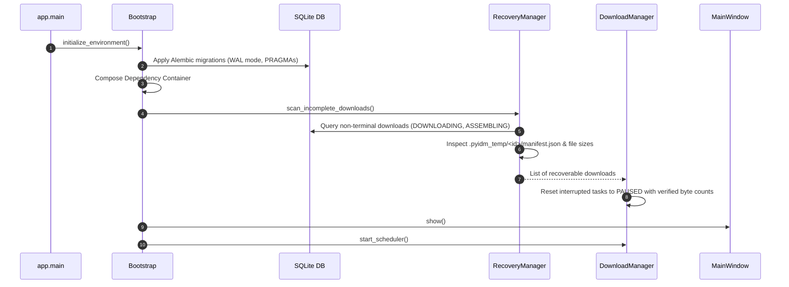
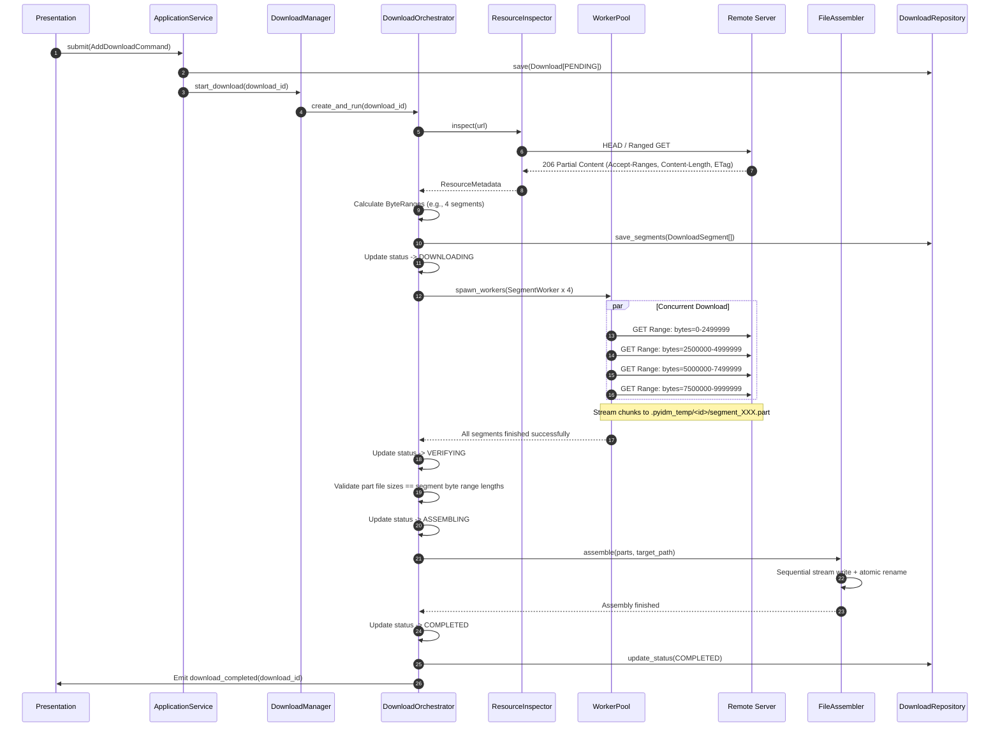
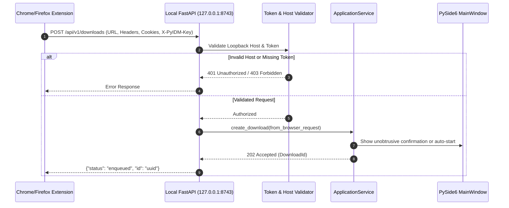

# Architecture Design — PyIDM

**Document version:** 1.0  
**Status:** Complete — Stage 1  
**Date:** 2026-11-08  
**Author:** Software Architecture Team

---

## 1. Architectural Philosophy and Principles

PyIDM is designed around strict separation of concerns, explicit boundaries, domain-driven design concepts, and clean layered architecture.

```mermaid
graph TD
    subgraph Presentation Layer [Presentation Layer: PySide6]
        W[Windows & Pages]
        MV[Models & Delegates]
        Ctrl[UI Controllers]
        Theme[Theme Engine]
    end

    subgraph Application Layer [Application Layer: Use Cases & Orchestration]
        Container[DI Container]
        AppSvc[Application Services]
        SigAdapter[DownloadSignalEmitter]
        Commands[Command & Query Handlers]
    end

    subgraph Domain Layer [Domain Layer: Pure Core Business Logic]
        Entities[Download & Segment Entities]
        ValueObj[ByteRange, DownloadSpeed, Url]
        DomSvc[SegmentCalc, StateValidator, Resolvers]
        DomEvents[Domain State Enums & Interfaces]
    end

    subgraph Engine Subsystem [Engine Subsystem: Download Execution]
        DM[DownloadManager]
        QM[QueueManager]
        SCH[DownloadScheduler]
        DO[DownloadOrchestrator]
        Workers[SegmentWorker Pool]
        Monitor[ProgressAggregator & TokenBucket]
        Assembler[FileAssembler]
    end

    subgraph Infrastructure Layer [Infrastructure Layer: Technical Details]
        Net[HttpStreamClient - HTTPX]
        Persist[SQLAlchemy 2.0 Repositories]
        FS[Filesystem & Temp Store]
        LocalApi[FastAPI Local Loopback Server]
        Sys[Clipboard & OS Notifications]
    end

    Presentation --> Application
    Application --> Domain
    Application --> Engine
    Engine --> Domain
    Engine --> Infrastructure
    Infrastructure ..|> Domain
    Application --> Infrastructure
```

### 1.1 Dependency Direction Rules
1. **Domain Layer** has zero dependencies on any UI framework, ORM, or HTTP library. Pure Python 3.11+ and standard typing.
2. **Presentation Layer** interacts exclusively with the Application Layer via controllers and typed Qt signals. No PySide6 widget ever accesses SQLite or executes an HTTP request.
3. **Download Engine** depends only on the Domain model and the networking/filesystem interfaces in the Infrastructure layer.
4. **Infrastructure Layer** implements abstract protocols defined by the Domain and Application layers.
5. **No `Any` Type**: All inter-layer boundaries are strictly typed with generics, dataclasses, or Pydantic models.

---

## 2. Layer Responsibilities & Component Directory

### 2.1 Presentation Layer (`app/presentation/`)
- **`windows/`**: `MainWindow` containing layout docking, toolbars, and status indicators.
- **`pages/`**: `DownloadDashboardPage`, `QueueManagerPage`, `SettingsPage`, `CategoryPage`.
- **`dialogs/`**: `AddDownloadDialog`, `DownloadDetailsDialog`, `BatchDownloadDialog`, `SettingsDialog`.
- **`models/`**: `DownloadTableModel` subclassing `QAbstractTableModel`. Implements cached cell updates and sorting.
- **`delegates/`**: `ProgressBarDelegate`, `SpeedDelegate`, `StatusBadgeDelegate` for native Qt drawing.
- **`controllers/`**: Mediates UI user actions (button clicks, menu triggers) and dispatches commands to the Application Layer.
- **`themes/`**: Light and dark QSS sheets with theme switching manager.

### 2.2 Application Layer (`app/application/`)
- **`container.py`**: Composes the dependency injection graph cleanly at application startup without relying on complex dynamic frameworks.
- **`application_service.py`**: Coordinates multi-domain operations (e.g., handling browser API requests, queue triggers, user commands).
- **`commands/`**: Command DTOs (`AddDownloadCommand`, `PauseDownloadCommand`, `ResumeDownloadCommand`, `CancelDownloadCommand`).
- **`handlers/`**: Command handlers executing use cases deterministically.
- **`signals/`**: `DownloadSignalEmitter`, which implements `ProgressReporter` protocol and safely pushes queued Qt signals to the main thread.

### 2.3 Domain Layer (`app/domain/`)
- **`downloads/entities/`**: `Download`, `DownloadSegment`, `DownloadCategory`.
- **`downloads/value_objects/`**: `DownloadId`, `SegmentId`, `ByteRange`, `DownloadSpeed`, `FileSize`, `DownloadUrl`, `HttpHeaders`, `RetryPolicy`.
- **`downloads/enums/`**: `DownloadStatus`, `SegmentStatus`, `DownloadStrategy`, `FailureCategory`, `Priority`.
- **`downloads/interfaces/`**: `DownloadRepository`, `SegmentRepository`, `QueueRepository`, `ResourceInspector`, `ProgressReporter`, `ManifestStorage`.
- **`downloads/services/`**: `SegmentCalculator`, `DownloadStateValidator`, `FilenameResolver`, `CategoryClassifier`, `SpeedCalculator`.
- **`queues/`**: `DownloadQueue`, `QueueSchedule`.

### 2.4 Download Engine Subsystem (`app/engine/`)
- **`manager/`**: `DownloadManager` controlling the thread pool, active orchestrators, and concurrency limits.
- **`downloader/`**: `DownloadOrchestrator`, `ResourceInspectorImpl`.
- **`segmentation/`**: Chunk management, range slicing, pre-allocation.
- **`workers/`**: `SegmentWorker`, `WorkerPool`.
- **`retry/`**: `RetryCoordinator` implementing exponential backoff with jitter and error classification.
- **`recovery/`**: `RecoveryManager` providing startup reconciliation between SQLite and `.pyidm_temp/` manifests.
- **`assembly/`**: `FileAssembler` performing atomic chunk streaming from part files into the final destination.
- **`monitoring/`**: `ProgressAggregator`, `RollingSpeedMeter`, `TokenBucket`.

### 2.5 Infrastructure Layer (`app/infrastructure/`)
- **`networking/`**: `HttpStreamClient` wrapping `httpx.Client` with connection pooling and timeouts.
- **`persistence/`**: `SqlDownloadRepository`, `SqlSegmentRepository`, `SqlQueueRepository`, SQLite connection bootstrap with WAL mode.
- **`filesystem/`**: Safe file operations, disk free space probing, path sanitization.
- **`configuration/`**: `PyIDMSettings` powered by `pydantic-settings`.
- **`logging/`**: Rotating structured JSON/text logging with sensitive header redaction.
- **`browser/`**: Local FastAPI loopback listener on `127.0.0.1` with API token verification.
- **`system/`**: System tray icon manager, native desktop notifications, OS clipboard watcher.

---

## 3. Core System Sequence Diagrams

### 3.1 Application Startup & Crash Recovery



### 3.2 Full Download Execution Sequence



### 3.3 Browser Extension Integration Architecture



---

## 4. Dependency Injection Strategy

PyIDM uses constructor injection through a clean, explicit `Container` class:

```python
class Container:
    def __init__(self, settings: PyIDMSettings) -> None:
        self.settings: PyIDMSettings = settings
        self.db_engine: Engine = create_sqlite_engine(settings.db_path)
        self.session_factory: sessionmaker[Session] = create_session_factory(self.db_engine)
        
        # Repositories
        self.download_repo: DownloadRepository = SqlDownloadRepository(self.session_factory)
        self.segment_repo: SegmentRepository = SqlSegmentRepository(self.session_factory)
        self.queue_repo: QueueRepository = SqlQueueRepository(self.session_factory)
        
        # Network & Engine
        self.http_client: HttpStreamClient = HttpStreamClient(timeout=settings.network_timeout)
        self.manifest_storage: ManifestStorage = JsonManifestStorage(settings.temp_dir)
        self.signal_emitter: DownloadSignalEmitter = DownloadSignalEmitter()
        
        self.download_manager: DownloadManager = DownloadManager(
            download_repo=self.download_repo,
            segment_repo=self.segment_repo,
            manifest_storage=self.manifest_storage,
            http_client=self.http_client,
            progress_reporter=self.signal_emitter,
            max_workers=settings.max_concurrent_downloads * settings.max_connections_per_download,
        )
        
        # Application Services
        self.app_service: ApplicationService = ApplicationService(
            download_manager=self.download_manager,
            download_repo=self.download_repo,
            queue_repo=self.queue_repo,
            settings=self.settings,
        )
```
- No global service locator.
- Pure object instantiation in top-down dependency order.
- Easy to mock in unit and integration test suites.

