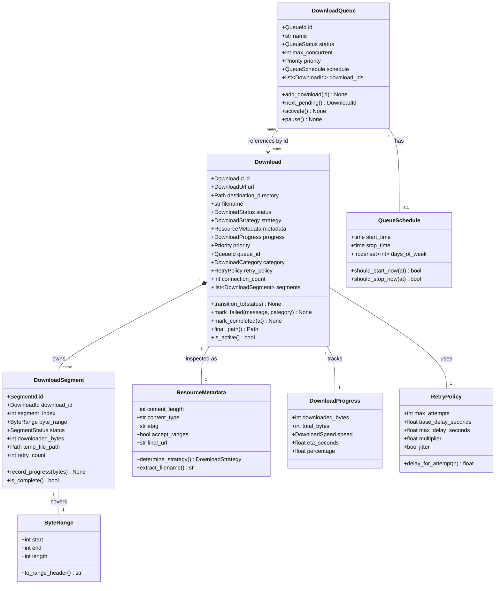

# Domain Model — PyIDM

**Document version:** 1.0  
**Status:** Draft — Stage 1  
**Date:** 2026-11-08

---

## 1. Overview

The domain layer contains the application's core business concepts. It has no dependencies on PySide6, HTTPX, SQLAlchemy, or any infrastructure library. It may use only the Python standard library and Pydantic for data validation and value objects.

The domain is organized into three bounded contexts:

- **Downloads** — The primary bounded context. Manages download entities, segments, state, and metadata.
- **Queues** — Manages collections of downloads with ordering and concurrency rules.
- **Scheduling** — Manages time-based triggers for queue and download operations.

---

## 2. Enumerations

### 2.1 DownloadStatus

```
PENDING      — Created, not yet queued.
QUEUED       — Added to a queue, waiting for a free worker slot.
INSPECTING   — Sending HEAD request; detecting file size and range support.
DOWNLOADING  — Active download; at least one segment worker is running.
PAUSING      — Pause has been requested; waiting for workers to stop.
PAUSED       — All workers stopped; progress persisted.
RESUMING     — Resume has been requested; workers being restarted.
VERIFYING    — All segments downloaded; verifying integrity.
ASSEMBLING   — Combining segment files into the final output file.
COMPLETED    — File assembled and verified. Download is done.
FAILED       — Non-recoverable failure. Error information attached.
CANCELLED    — Cancelled by user. Temporary files subject to cleanup policy.
```

### 2.2 SegmentStatus

```
PENDING      — Not yet started.
DOWNLOADING  — Actively downloading bytes.
PAUSED       — Stopped mid-segment; can be resumed.
COMPLETED    — All bytes for this segment received and verified.
FAILED       — This segment failed beyond its retry limit.
```

### 2.3 DownloadStrategy

```
SINGLE_STREAM   — One connection, full content download.
SEGMENTED       — Multiple connections with byte-range segments.
```

### 2.4 FailureCategory

```
TRANSIENT_NETWORK   — DNS, connection reset, timeout. Retryable.
SERVER_ERROR        — HTTP 5xx. Retryable with backoff.
RATE_LIMITED        — HTTP 429. Retryable after Retry-After delay.
AUTHENTICATION      — HTTP 401/403. Not automatically retryable.
NOT_FOUND           — HTTP 404/410. Permanent failure.
RANGE_REJECTED      — HTTP 416. Requires strategy recalculation.
DISK_FULL           — OS error ENOSPC. Paused until space available.
PERMISSION_DENIED   — OS error EACCES. User action required.
RESOURCE_CHANGED    — ETag/Last-Modified mismatch on resume. User decision required.
UNKNOWN             — Unclassified. Treated as potentially transient.
```

### 2.5 QueueStatus

```
IDLE        — Queue exists but no active downloads.
RUNNING     — Queue is processing downloads.
PAUSED      — Queue processing is suspended.
SCHEDULED   — Queue will start at a configured time.
```

### 2.6 Priority

```
LOW     = 1
NORMAL  = 2
HIGH    = 3
URGENT  = 4
```

### 2.7 DownloadCategory

```
DOCUMENTS
APPLICATIONS
ARCHIVES
VIDEOS
AUDIO
IMAGES
OTHER
```

---

## 3. Value Objects

Value objects are immutable. Equality is based on their content, not identity.

### 3.1 DownloadId

```
Type: UUID (newtype wrapper around uuid.UUID)
Purpose: Uniquely identifies a download across the application.
Invariants: Never empty. Generated at creation time. Never changed.
```

### 3.2 SegmentId

```
Type: UUID (newtype wrapper around uuid.UUID)
Purpose: Uniquely identifies a segment within a download.
```

### 3.3 QueueId

```
Type: UUID (newtype wrapper around uuid.UUID)
Purpose: Uniquely identifies a download queue.
```

### 3.4 ByteRange

```
Attributes:
  start: int  — Inclusive start byte offset (>= 0)
  end: int    — Inclusive end byte offset (>= start)

Properties:
  length: int — end - start + 1

Methods:
  to_range_header() -> str  — Returns "bytes=start-end"

Invariants:
  start >= 0
  end >= start
  length >= 1
```

### 3.5 DownloadSpeed

```
Attributes:
  bytes_per_second: float  — Current speed in bytes/second

Properties:
  as_kbps: float
  as_mbps: float
  formatted: str  — Human-readable, e.g. "2.4 MB/s"

Invariants:
  bytes_per_second >= 0.0
```

### 3.6 FileSize

```
Attributes:
  bytes: int  — Total byte count (-1 if unknown)

Properties:
  is_known: bool
  as_mb: float
  formatted: str

Invariants:
  bytes >= -1  (-1 means unknown)
```

### 3.7 DownloadUrl

```
Attributes:
  raw: str            — Original URL string
  scheme: str         — 'http' or 'https'
  host: str
  path: str
  query: str | None

Methods:
  validated() -> DownloadUrl  — Raises InvalidUrlError if invalid

Invariants:
  scheme in ('http', 'https')
  host is not empty
  raw is not empty
```

### 3.8 HttpHeaders

```
Type: Immutable mapping of str -> str
Purpose: Represents HTTP request or response headers.
Methods:
  get(name: str) -> str | None
  items() -> Iterable[tuple[str, str]]
  with_header(name: str, value: str) -> HttpHeaders
```

### 3.9 RetryPolicy

```
Attributes:
  max_attempts: int           — Maximum retry count (1–20)
  base_delay_seconds: float   — Initial backoff delay
  max_delay_seconds: float    — Maximum backoff cap
  multiplier: float           — Exponential multiplier (default 2.0)
  jitter: bool                — Whether to add random jitter

Methods:
  delay_for_attempt(attempt: int) -> float
```

### 3.10 DownloadProgress

```
Attributes:
  downloaded_bytes: int
  total_bytes: int | None
  speed: DownloadSpeed
  eta_seconds: float | None
  segment_count: int
  completed_segment_count: int

Properties:
  percentage: float | None
  is_size_known: bool
```

### 3.11 ResourceMetadata

```
Attributes:
  content_length: int | None
  content_type: str | None
  content_disposition: str | None
  etag: str | None
  last_modified: str | None
  accept_ranges: bool
  final_url: str
  suggested_filename: str | None

Methods:
  extract_filename() -> str | None
  determine_strategy() -> DownloadStrategy
```

### 3.12 SegmentManifest

```
Attributes:
  download_id: DownloadId
  total_size: int | None
  strategy: DownloadStrategy
  segments: list[SegmentRecord]
  etag: str | None
  last_modified: str | None
  created_at: datetime

Methods:
  is_complete() -> bool
  incomplete_segments() -> list[SegmentRecord]
  to_json() -> str
  from_json(data: str) -> SegmentManifest
```

---

## 4. Entities

Entities have identity. Two entities with the same ID are the same entity, regardless of their attribute values.

### 4.1 Download (Aggregate Root)

```
Responsibility:
  Central entity for a single download task. Owns its segments.
  Enforces state transition rules. Guards its own invariants.

Attributes:
  id: DownloadId
  url: DownloadUrl
  destination_directory: Path
  filename: str
  status: DownloadStatus
  strategy: DownloadStrategy | None
  metadata: ResourceMetadata | None
  progress: DownloadProgress
  priority: Priority
  queue_id: QueueId | None
  category: DownloadCategory
  retry_policy: RetryPolicy
  connection_count: int
  speed_limit_bps: int | None     — None means unlimited
  custom_headers: HttpHeaders
  created_at: datetime
  started_at: datetime | None
  completed_at: datetime | None
  failed_at: datetime | None
  error_message: str | None
  error_category: FailureCategory | None
  segments: list[DownloadSegment]

Public Methods:
  transition_to(status: DownloadStatus) -> None
    — Validates and applies a state transition. Raises InvalidTransitionError.
  add_segment(segment: DownloadSegment) -> None
  get_segment(segment_id: SegmentId) -> DownloadSegment | None
  update_progress(progress: DownloadProgress) -> None
  mark_failed(message: str, category: FailureCategory) -> None
  mark_completed(completed_at: datetime) -> None
  mark_cancelled() -> None
  final_path() -> Path
    — Returns destination_directory / filename
  is_active() -> bool
    — True when status is DOWNLOADING, PAUSING, or RESUMING

Invariants:
  id is immutable after creation
  url.scheme in ('http', 'https')
  connection_count >= 1
  filename is not empty
  destination_directory is a valid directory path
  Invalid transitions raise InvalidTransitionError
```

**Valid state transitions:**

```
PENDING      -> INSPECTING, CANCELLED
INSPECTING   -> QUEUED, DOWNLOADING, FAILED, CANCELLED
QUEUED       -> DOWNLOADING, CANCELLED
DOWNLOADING  -> PAUSING, VERIFYING, FAILED, CANCELLED
PAUSING      -> PAUSED, FAILED
PAUSED       -> RESUMING, CANCELLED
RESUMING     -> DOWNLOADING, FAILED, CANCELLED
VERIFYING    -> ASSEMBLING, FAILED
ASSEMBLING   -> COMPLETED, FAILED
COMPLETED    -> (terminal)
FAILED       -> PENDING  (manual retry resets to PENDING)
CANCELLED    -> (terminal)
```

### 4.2 DownloadSegment

```
Responsibility:
  Represents one byte-range slice of a download.

Attributes:
  id: SegmentId
  download_id: DownloadId
  segment_index: int
  byte_range: ByteRange
  status: SegmentStatus
  downloaded_bytes: int
  temp_file_path: Path | None
  retry_count: int
  error_message: str | None
  started_at: datetime | None
  completed_at: datetime | None

Public Methods:
  current_offset() -> int
    — Returns byte_range.start + downloaded_bytes
  remaining_bytes() -> int
  is_complete() -> bool
  mark_completed(completed_at: datetime) -> None
  mark_failed(message: str) -> None
  record_progress(bytes_written: int) -> None

Invariants:
  downloaded_bytes <= byte_range.length
  segment_index >= 0
  retry_count >= 0
```

### 4.3 DownloadQueue

```
Responsibility:
  Manages an ordered collection of downloads with scheduling and concurrency rules.

Attributes:
  id: QueueId
  name: str
  status: QueueStatus
  max_concurrent: int
  priority: Priority
  schedule: QueueSchedule | None
  download_ids: list[DownloadId]  — Ordered list
  created_at: datetime

Public Methods:
  add_download(download_id: DownloadId) -> None
  remove_download(download_id: DownloadId) -> None
  reorder(download_id: DownloadId, new_index: int) -> None
  next_pending() -> DownloadId | None
  activate() -> None
  pause() -> None
  is_running() -> bool

Invariants:
  max_concurrent >= 1
  name is not empty
  download_ids contains no duplicates
```

### 4.4 QueueSchedule

```
Responsibility:
  Defines time-based rules for when a queue should run.

Attributes:
  start_time: time | None
  stop_time: time | None
  days_of_week: frozenset[int]  — 0=Monday … 6=Sunday
  is_recurring: bool
  next_start: datetime | None
  next_stop: datetime | None

Public Methods:
  should_start_now(at: datetime) -> bool
  should_stop_now(at: datetime) -> bool
  next_trigger(at: datetime) -> datetime | None
```

### 4.5 DownloadCategory (Entity)

```
Responsibility:
  Represents a user-defined or built-in download category.

Attributes:
  id: UUID
  name: str
  builtin_type: DownloadCategory | None
  default_directory: Path | None
  mime_types: frozenset[str]
  extensions: frozenset[str]

Public Methods:
  matches(content_type: str, filename: str) -> bool
```

---

## 5. Domain Services

Domain services contain business logic that does not naturally belong to a single entity.

### 5.1 SegmentCalculator

```
Responsibility:
  Calculates how to divide a file into segments.

Dependencies: None

Public Methods:
  calculate(
    total_size: int,
    connection_count: int,
    min_segment_bytes: int = 1_048_576,  # 1 MB minimum
  ) -> list[ByteRange]

Rules:
  - If total_size < min_segment_bytes, returns a single range covering the full file.
  - If connection_count > total_size / min_segment_bytes, reduces connection count.
  - Segments are contiguous and cover exactly total_size bytes.
  - The last segment absorbs any remainder.
```

### 5.2 DownloadStateValidator

```
Responsibility:
  Encapsulates the state transition rule table.
  Prevents invalid transitions from being applied.

Dependencies: None

Public Methods:
  validate(current: DownloadStatus, next: DownloadStatus) -> None
    — Raises InvalidTransitionError if the transition is not allowed.
  valid_next_states(current: DownloadStatus) -> frozenset[DownloadStatus]
```

### 5.3 FilenameResolver

```
Responsibility:
  Determines the final safe filename for a download.

Dependencies: None

Public Methods:
  resolve(
    suggested_filename: str | None,
    url: DownloadUrl,
    content_disposition: str | None,
    existing_files: set[str],
  ) -> str

Rules:
  - Prefer Content-Disposition filename if present.
  - Fall back to URL path basename.
  - Fall back to a generated name if neither is available.
  - Sanitize: remove illegal characters, truncate to 255 chars.
  - Reject path separators and traversal sequences.
  - Append (1), (2), etc. if filename already exists in the destination.
```

### 5.4 CategoryClassifier

```
Responsibility:
  Classifies a download into a category based on MIME type and filename.

Dependencies: None

Public Methods:
  classify(
    content_type: str | None,
    filename: str,
  ) -> DownloadCategory
```

### 5.5 SpeedCalculator

```
Responsibility:
  Calculates rolling download speed from a stream of byte count samples.

Dependencies: None

Attributes:
  window_seconds: float — Rolling window duration (default 5.0)

Public Methods:
  record(bytes_received: int, at: datetime) -> None
  current_speed() -> DownloadSpeed
  average_speed() -> DownloadSpeed
  eta(remaining_bytes: int) -> float | None  — Returns seconds
```

### 5.6 RetryDecisionMaker

```
Responsibility:
  Decides whether and when to retry a failed operation.

Dependencies: None

Public Methods:
  should_retry(
    attempt: int,
    error_category: FailureCategory,
    policy: RetryPolicy,
    retry_after_seconds: float | None,
  ) -> tuple[bool, float]
    — Returns (should_retry, delay_seconds)
```

---

## 6. Domain Interfaces (Protocols)

These are defined in `app/domain/downloads/interfaces/` and represent contracts that infrastructure components must fulfill.

### 6.1 DownloadRepository

```python
class DownloadRepository(Protocol):
    def save(self, download: Download) -> None: ...
    def get_by_id(self, download_id: DownloadId) -> Download | None: ...
    def get_all(self) -> list[Download]: ...
    def get_by_status(self, status: DownloadStatus) -> list[Download]: ...
    def get_active(self) -> list[Download]: ...
    def delete(self, download_id: DownloadId) -> None: ...
    def update_status(self, download_id: DownloadId, status: DownloadStatus) -> None: ...
    def update_progress(self, download_id: DownloadId, progress: DownloadProgress) -> None: ...
```

### 6.2 SegmentRepository

```python
class SegmentRepository(Protocol):
    def save_all(self, segments: list[DownloadSegment]) -> None: ...
    def get_by_download(self, download_id: DownloadId) -> list[DownloadSegment]: ...
    def update_segment(self, segment: DownloadSegment) -> None: ...
    def delete_by_download(self, download_id: DownloadId) -> None: ...
```

### 6.3 QueueRepository

```python
class QueueRepository(Protocol):
    def save(self, queue: DownloadQueue) -> None: ...
    def get_by_id(self, queue_id: QueueId) -> DownloadQueue | None: ...
    def get_all(self) -> list[DownloadQueue]: ...
    def update(self, queue: DownloadQueue) -> None: ...
    def delete(self, queue_id: QueueId) -> None: ...
```

### 6.4 ResourceInspector

```python
class ResourceInspector(Protocol):
    def inspect(self, url: DownloadUrl, headers: HttpHeaders) -> ResourceMetadata: ...
```

### 6.5 ProgressReporter

```python
class ProgressReporter(Protocol):
    def report(self, download_id: DownloadId, progress: DownloadProgress) -> None: ...
    def report_segment(self, segment_id: SegmentId, bytes_written: int) -> None: ...
    def report_status_change(self, download_id: DownloadId, status: DownloadStatus) -> None: ...
    def report_error(self, download_id: DownloadId, message: str) -> None: ...
```

### 6.6 ManifestStorage

```python
class ManifestStorage(Protocol):
    def save(self, manifest: SegmentManifest) -> None: ...
    def load(self, download_id: DownloadId) -> SegmentManifest | None: ...
    def delete(self, download_id: DownloadId) -> None: ...
    def exists(self, download_id: DownloadId) -> bool: ...
```

---

## 7. Domain Exceptions

All domain exceptions inherit from `PyIDMDomainError`.

```
PyIDMDomainError                    — Base for all domain errors
├── InvalidTransitionError          — State machine violation
├── InvalidUrlError                 — URL validation failure
├── InvalidSegmentError             — Segment configuration problem
├── DownloadNotFoundError           — Requested download does not exist
├── QueueNotFoundError              — Requested queue does not exist
├── DuplicateDownloadError          — URL already exists in active downloads
└── InvalidFilenameError            — Unsafe or malformed filename
```

---

## 8. Domain Model Diagram



---

## 9. Invariant Summary

| Entity | Critical Invariants |
|--------|---------------------|
| Download | State transitions only through `transition_to()`. ID is immutable. URL scheme is http/https. |
| DownloadSegment | `downloaded_bytes` ≤ `byte_range.length`. Index is non-negative. |
| ByteRange | `start` ≤ `end`. Both ≥ 0. |
| DownloadQueue | No duplicate download IDs. `max_concurrent` ≥ 1. |
| RetryPolicy | `max_attempts` ≥ 1. `base_delay_seconds` > 0. |
| DownloadUrl | Scheme must be http or https. Host must not be empty. |

