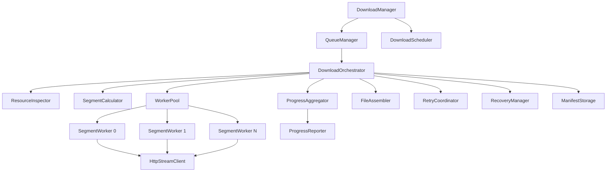
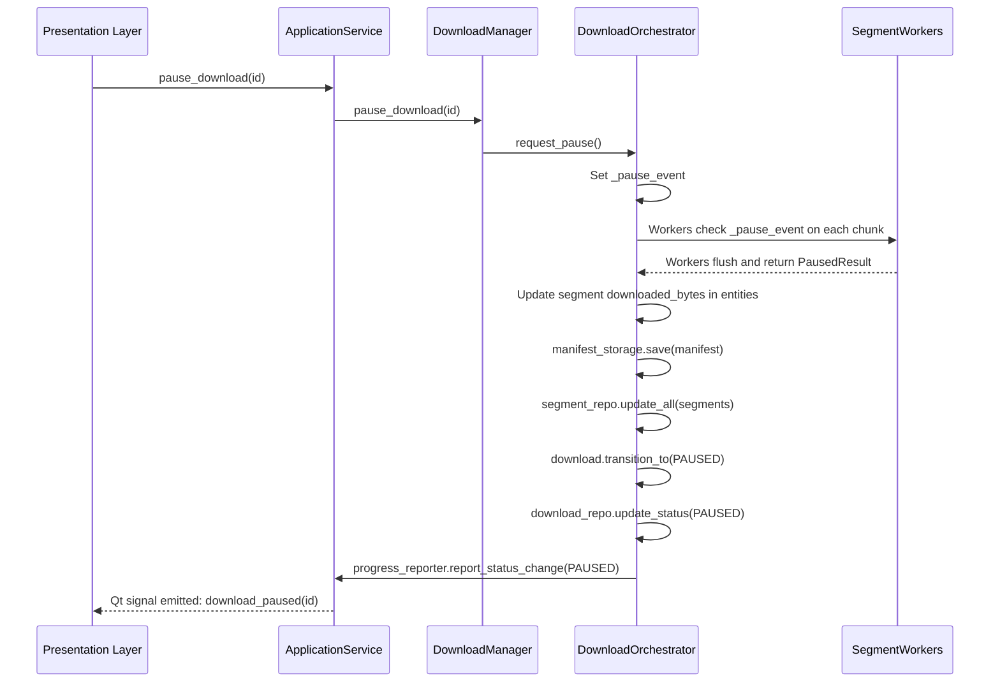
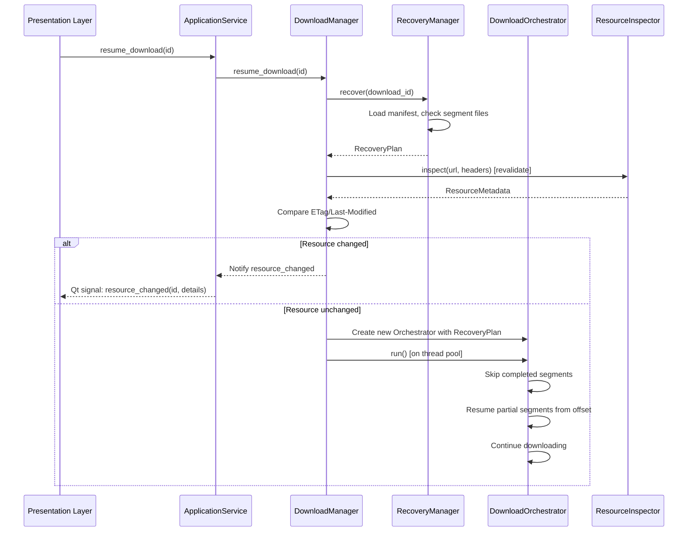

# Download Engine Design — PyIDM

**Document version:** 1.0  
**Status:** Draft — Stage 1  
**Date:** 2026-11-08

---

## 1. Overview

The download engine is the most critical subsystem of PyIDM. It is responsible for all network I/O, segment management, progress tracking, retry handling, and file assembly.

The engine is completely decoupled from the GUI. It communicates with the presentation layer exclusively through the `ProgressReporter` protocol and Qt signals emitted by an adapter in the application layer.

The engine is independently testable and can run in a headless environment.

---

## 2. Engine Subsystem Map



---

## 3. Core Engine Classes

### 3.1 DownloadManager

**Package:** `app/engine/manager/`

```
Responsibility:
  Top-level engine coordinator. The single entry point for all download
  operations from the application layer. Manages the global thread pool.
  Coordinates QueueManager and DownloadScheduler. Enforces global
  concurrency limits.

Attributes:
  _queue_manager: QueueManager
  _scheduler: DownloadScheduler
  _orchestrators: dict[DownloadId, DownloadOrchestrator]
  _thread_pool: ThreadPoolExecutor
  _max_concurrent_downloads: int
  _download_repo: DownloadRepository
  _progress_reporter: ProgressReporter
  _lock: threading.Lock

Public Methods:
  start() -> None
    — Starts the manager, recovers unfinished downloads, starts scheduler.
  stop() -> None
    — Gracefully stops all active downloads, shuts down thread pool.
  add_download(request: AddDownloadRequest) -> DownloadId
    — Validates, creates Download entity, persists, enqueues.
  start_download(download_id: DownloadId) -> None
    — Moves a PENDING or QUEUED download to INSPECTING, begins orchestration.
  pause_download(download_id: DownloadId) -> None
    — Signals the orchestrator for the given download to pause.
  resume_download(download_id: DownloadId) -> None
    — Loads persisted state, creates new orchestrator, begins resume.
  cancel_download(download_id: DownloadId) -> None
    — Signals orchestrator to cancel, cleans up resources.
  get_active_count() -> int
  set_global_speed_limit(bps: int | None) -> None
  set_max_concurrent(limit: int) -> None

Threading:
  - All public methods are thread-safe (guarded by _lock or atomic operations).
  - Orchestrators run on worker threads from _thread_pool.
  - _orchestrators dict is guarded by _lock.
  - The manager itself runs on the main application thread.
```

### 3.2 DownloadOrchestrator

**Package:** `app/engine/downloader/`

```
Responsibility:
  Manages the full lifecycle of a single download from INSPECTING through
  COMPLETED or FAILED. Coordinates ResourceInspector, SegmentWorker pool,
  ProgressAggregator, RetryCoordinator, FileAssembler, and ManifestStorage.

Attributes:
  _download: Download
  _inspector: ResourceInspector
  _segment_calculator: SegmentCalculator
  _worker_pool: WorkerPool
  _retry_coordinator: RetryCoordinator
  _assembler: FileAssembler
  _manifest_storage: ManifestStorage
  _progress_aggregator: ProgressAggregator
  _progress_reporter: ProgressReporter
  _cancel_event: threading.Event
  _pause_event: threading.Event

Public Methods:
  run() -> None
    — Full orchestration: inspect -> plan -> download -> assemble -> verify.
    — Called from a worker thread by DownloadManager.
  request_pause() -> None
    — Sets _pause_event. Workers check this cooperatively.
  request_cancel() -> None
    — Sets _cancel_event. Workers terminate promptly.
  is_paused() -> bool
  is_cancelled() -> bool

Internal Flow:
  1. Call _inspector.inspect(url, headers) -> ResourceMetadata
  2. Update Download with metadata. Persist.
  3. If range supported and file > min_size:
       segments = _segment_calculator.calculate(size, conn_count)
       Create DownloadSegment entities. Persist.
       strategy = SEGMENTED
     Else:
       segments = [ByteRange(0, total_size - 1)] (or open-ended)
       strategy = SINGLE_STREAM
  4. Save manifest via _manifest_storage.
  5. Transition Download to DOWNLOADING.
  6. Submit segments to _worker_pool.
  7. Wait for all workers to complete (or pause/cancel).
  8. If paused: persist progress, return.
  9. If cancelled: cleanup, return.
  10. Transition to VERIFYING.
  11. Verify segments (file sizes match byte ranges).
  12. Transition to ASSEMBLING.
  13. _assembler.assemble(download, segments) -> Path
  14. Transition to COMPLETED.
  15. Clean up temp files.
  16. Delete manifest.
```

### 3.3 ResourceInspector

**Package:** `app/engine/downloader/`

```
Responsibility:
  Sends HTTP HEAD (or GET if HEAD fails) to determine file metadata.
  Detects range support, file size, ETag, content type, and suggested filename.

Dependencies:
  _http_client: HttpStreamClient

Public Methods:
  inspect(url: DownloadUrl, headers: HttpHeaders) -> ResourceMetadata

Logic:
  1. Send HEAD request.
  2. If 405/501/4xx: fall back to ranged GET (Range: bytes=0-0) to detect
     Content-Length and Accept-Ranges without downloading content.
  3. If server ignores Range or returns 200 instead of 206: set accept_ranges=False.
  4. Parse Content-Length -> total size.
  5. Parse Accept-Ranges: bytes -> range support flag.
  6. Parse ETag, Last-Modified, Content-Type, Content-Disposition.
  7. Follow redirects; record final URL.
  8. Return ResourceMetadata.

Fallback Strategies:
  - HEAD not supported -> ranged GET bytes=0-0.
  - Ranged GET returns 200 -> single stream only.
  - No Content-Length -> streaming download with unknown size.
  - Content-Length mismatch after download -> integrity failure.
```

### 3.4 SegmentWorker

**Package:** `app/engine/workers/`

```
Responsibility:
  Downloads one byte-range segment of a file.
  Streams content to a temporary file in configurable chunks.
  Reports progress. Checks pause/cancel events cooperatively.

Attributes:
  _segment: DownloadSegment
  _download: Download
  _http_client: HttpStreamClient
  _cancel_event: threading.Event
  _pause_event: threading.Event
  _progress_reporter: ProgressReporter
  _retry_coordinator: RetryCoordinator
  _chunk_size: int  — Default 65536 (64 KB)
  _speed_limiter: SpeedLimiter | None

Public Methods:
  run() -> SegmentResult

Internal Flow:
  1. Open _segment.temp_file_path in append/write mode.
  2. Determine start offset: segment.byte_range.start + segment.downloaded_bytes.
  3. Send ranged GET for the remaining range.
  4. For each chunk from the streaming response:
       a. Check _cancel_event. If set, return SegmentResult(cancelled=True).
       b. Check _pause_event. If set, flush, persist progress, return paused result.
       c. Write chunk to file.
       d. Update segment.downloaded_bytes.
       e. Throttle if _speed_limiter is active.
       f. Report progress to _progress_reporter.
  5. Verify segment file size matches byte_range.length.
  6. Return SegmentResult(completed=True).
```

### 3.5 WorkerPool

**Package:** `app/engine/workers/`

```
Responsibility:
  Manages the submission of SegmentWorker tasks to a ThreadPoolExecutor.
  Collects results. Coordinates cancellation and pause propagation.

Attributes:
  _executor: ThreadPoolExecutor
  _futures: dict[SegmentId, Future[SegmentResult]]
  _cancel_event: threading.Event
  _pause_event: threading.Event

Public Methods:
  submit_workers(workers: list[SegmentWorker]) -> None
  wait_for_completion() -> list[SegmentResult]
  cancel_all() -> None
  pause_all() -> None

Notes:
  - The ExecutorPool is bounded: max_workers = min(connection_count, global_pool_limit)
  - Futures are stored for cancellation signaling.
  - On completion, futures are released.
```

### 3.6 RetryCoordinator

**Package:** `app/engine/retry/`

```
Responsibility:
  Decides whether to retry a failed segment and waits the appropriate delay.
  Wraps RetryDecisionMaker with actual wait behavior.

Attributes:
  _decision_maker: RetryDecisionMaker
  _cancel_event: threading.Event

Public Methods:
  retry_or_raise(
    attempt: int,
    exception: Exception,
    policy: RetryPolicy,
    retry_after: float | None = None,
  ) -> None
    — Either sleeps for the calculated delay or raises the exception.
    — Checks _cancel_event during the wait to allow fast cancellation.

classify_error(exception: Exception) -> FailureCategory
  — Maps network and HTTP exceptions to FailureCategory values.
```

### 3.7 FileAssembler

**Package:** `app/engine/assembly/`

```
Responsibility:
  Combines segment temporary files into the final output file.
  Uses atomic operations to prevent partial output visibility.

Attributes:
  _chunk_size: int  — Read/write chunk size (default 64 KB)

Public Methods:
  assemble(
    download: Download,
    segments: list[DownloadSegment],
    output_path: Path,
  ) -> Path

Internal Flow:
  1. Sort segments by segment_index.
  2. Create a temporary output file in the same directory as output_path.
  3. For each segment:
       a. Open segment.temp_file_path.
       b. Read and write in chunks to temp output.
  4. Verify temp output size equals expected total_bytes.
  5. Rename temp output to output_path atomically (os.replace).
  6. Return output_path.

Error Handling:
  - If assembly fails partway, the incomplete temp output is deleted.
  - The final rename is atomic on POSIX and best-effort on Windows.
  - On Windows, falls back to shutil.move if os.replace across volumes fails.
```

### 3.8 ProgressAggregator

**Package:** `app/engine/monitoring/`

```
Responsibility:
  Aggregates segment-level progress into download-level progress.
  Throttles progress reporting to avoid GUI flooding.

Attributes:
  _download_id: DownloadId
  _segments: list[DownloadSegment]
  _speed_calculator: SpeedCalculator
  _reporter: ProgressReporter
  _last_report_time: datetime
  _report_interval_seconds: float  — Default 0.4
  _total_bytes: int | None

Public Methods:
  record_bytes(segment_id: SegmentId, bytes_written: int) -> None
  force_report() -> None
  get_current_progress() -> DownloadProgress

Internal Logic:
  - Maintains per-segment byte counters (thread-safe via threading.Lock).
  - Total downloaded = sum of per-segment counters.
  - Calls SpeedCalculator.record() for each update.
  - Throttles: only calls _reporter.report() if elapsed > _report_interval_seconds.
  - force_report() bypasses the throttle (called on pause/completion).
```

### 3.9 RecoveryManager

**Package:** `app/engine/recovery/`

```
Responsibility:
  Executed at application startup. Finds unfinished downloads, validates
  their temporary files, and determines what can be recovered.

Dependencies:
  _download_repo: DownloadRepository
  _segment_repo: SegmentRepository
  _manifest_storage: ManifestStorage
  _inspector: ResourceInspector

Public Methods:
  scan_incomplete() -> list[RecoveryCandidate]
  recover(download_id: DownloadId) -> RecoveryPlan

RecoveryCandidate:
  download: Download
  manifest: SegmentManifest
  segments_on_disk: list[SegmentFileInfo]
  recoverable: bool
  reason: str | None

RecoveryPlan:
  download_id: DownloadId
  segments_to_redo: list[ByteRange]
  segments_already_done: list[SegmentId]

Internal Flow for scan_incomplete():
  1. Load all downloads with status in (DOWNLOADING, PAUSING, PAUSED, RESUMING, INSPECTING, ASSEMBLING, VERIFYING).
  2. For each:
       a. Load manifest from ManifestStorage.
       b. For each segment in manifest:
            - Check temp file exists.
            - Verify file size >= expected downloaded_bytes.
       c. Flag as recoverable if at least some segments are intact.
  3. Return candidates with recovery assessment.

Internal Flow for recover():
  1. Load RecoveryCandidate.
  2. Cross-reference database segments with disk files.
  3. For each segment:
       - If temp file complete: mark COMPLETED, do not re-download.
       - If temp file partial: adjust downloaded_bytes to actual file size.
       - If temp file missing: reset to PENDING with downloaded_bytes=0.
  4. Return RecoveryPlan.
```

### 3.10 SpeedLimiter (Token Bucket)

**Package:** `app/engine/monitoring/`

```
Responsibility:
  Throttles the byte-write rate to enforce bandwidth limits.
  Uses the token bucket algorithm.

Attributes:
  _rate_bps: float           — Tokens per second (bytes)
  _bucket_size: float        — Maximum bucket capacity
  _tokens: float             — Current token count
  _last_refill: float        — Timestamp of last refill
  _lock: threading.Lock

Public Methods:
  consume(bytes_count: int) -> None
    — Blocks the calling thread until enough tokens are available.
    — Called by SegmentWorker after writing each chunk.
  set_rate(bps: float) -> None
  disable() -> None

Algorithm:
  On each consume(n):
    1. Compute elapsed = now - _last_refill.
    2. Refill: _tokens = min(_bucket_size, _tokens + elapsed * _rate_bps).
    3. Update _last_refill.
    4. If _tokens >= n: subtract n, return immediately.
    5. Else: sleep (n - _tokens) / _rate_bps seconds, subtract n.
```

### 3.11 HttpStreamClient

**Package:** `app/infrastructure/networking/`

```
Responsibility:
  Thin adapter over HTTPX. Provides streaming HTTP requests.
  Encapsulates connection pooling, timeouts, and retry transport.

Dependencies:
  _client: httpx.Client  — Synchronous HTTPX client with connection pooling

Public Methods:
  head(url: str, headers: dict[str, str]) -> HttpResponse
  get(url: str, headers: dict[str, str]) -> HttpResponse
    — Returns a non-streaming response for small HEAD-equivalent requests
  stream_get(
    url: str,
    headers: dict[str, str],
    chunk_size: int,
  ) -> Iterator[bytes]
    — Streams the response body in chunks of chunk_size bytes.
  close() -> None

Configuration:
  - follow_redirects=True (up to 10)
  - timeout: httpx.Timeout(connect=15.0, read=30.0, write=10.0, pool=5.0)
  - limits: httpx.Limits(max_connections=100, max_keepalive_connections=20)

Notes:
  - Each segment worker gets a stream from the shared _client.
  - HTTPX synchronous client uses connection pooling automatically.
  - Resource headers (Authorization, Cookie) are included in every request.
  - Sensitive headers are redacted before logging.
```

---

## 4. Download Strategies

### 4.1 Single-Stream Download

**When used:**
- Server does not support range requests.
- File is smaller than the minimum segment size.
- User explicitly selects 1 connection.
- Range detection fails or times out.

**Mechanism:**
- One `SegmentWorker` with a `ByteRange(0, total_size - 1)` (or open-ended if size unknown).
- Streams to a single temp file.
- Assembly step is trivial (rename the temp file).

**Advantages:**
- Simpler. Works universally.
- Lower overhead.
- Safe for all servers.

**Disadvantages:**
- Cannot exploit servers offering range support.
- No parallelism.
- Full re-download required if interrupted (unless server supports ranges, which single-stream can still use with partial recovery).

### 4.2 Fixed Segmented Download

**When used:**
- Server confirms range support via Accept-Ranges: bytes.
- File size is known and exceeds the minimum segment threshold.

**Mechanism:**
- N segments computed at download start.
- N `SegmentWorker` instances submit N range requests concurrently.
- Each segment writes to its own temp file.
- `FileAssembler` combines temp files in order.

**Advantages:**
- Parallelism can saturate bandwidth-limited connections.
- Independent retry per segment.
- Resume only downloads missing portions.

**Disadvantages:**
- Higher resource usage (N connections, N file handles).
- Requires server range support.
- Assembly step adds latency.
- Some CDNs throttle per-connection; more connections may not improve speed.

### 4.3 Dynamic Segment Splitting (Future Consideration)

A fast-finishing segment could split its remaining work and spawn an additional worker. This adds significant complexity and is not included in the initial release. It is listed as a planned enhancement.

### 4.4 Strategy Selection Logic

```
inspect() returns ResourceMetadata
  if metadata.accept_ranges and metadata.content_length > MIN_SEGMENT_BYTES:
      strategy = SEGMENTED
      connection_count = download.connection_count
  else:
      strategy = SINGLE_STREAM
      connection_count = 1
```

---

## 5. Temporary Storage Layout

```
downloads/
└── .pyidm_temp/
    └── <download_id as hex>/
        ├── manifest.json         ← SegmentManifest serialized to JSON
        ├── segment_000.part      ← Bytes for segment 0
        ├── segment_001.part      ← Bytes for segment 1
        ├── segment_002.part      ← Bytes for segment 2
        └── segment_003.part      ← Bytes for segment 3
```

**Manifest structure (JSON):**

```json
{
  "schema_version": 1,
  "download_id": "uuid-hex",
  "total_size": 104857600,
  "strategy": "SEGMENTED",
  "etag": "\"abc123\"",
  "last_modified": "Sat, 01 Jan 2026 00:00:00 GMT",
  "created_at": "2026-11-08T00:00:00Z",
  "segments": [
    {
      "id": "uuid-hex",
      "index": 0,
      "start": 0,
      "end": 26214399,
      "downloaded_bytes": 26214400,
      "status": "COMPLETED"
    }
  ]
}
```

**Rules:**
- Temp directory is hidden (prefixed with `.`).
- Each download has its own subdirectory named by its UUID.
- Manifest is updated atomically: write to `.manifest.tmp`, then rename.
- Segment files are opened in write mode (not append) for a new download.
- On resume, segment files are opened in `r+b` mode and seeked to the current offset.
- The final assembled file is written to a `.assembling` temp name, then renamed.

---

## 6. Failure Scenarios and Mitigations

| Scenario | Detection | Mitigation |
|----------|-----------|------------|
| Network disconnection mid-segment | Socket error / HTTPX ReadError | Segment retried with exponential backoff |
| Server returns 200 instead of 206 | Response code check | Switch to single-stream strategy |
| HTTP 416 on resume | Response code 416 | Re-inspect resource; if size changed, ask user |
| ETag changed on resume | ETag mismatch in ResourceMetadata | Notify user; offer full re-download |
| Disk full during write | OSError ENOSPC | Pause download; notify user |
| Segment temp file missing on resume | File not found | Reset that segment to PENDING, re-download |
| Assembly fails midway | Exception during FileAssembler | Delete partial output; leave temp files for retry |
| Application crash during ASSEMBLING | Startup recovery finds ASSEMBLING state | Attempt re-assembly from intact segments |
| All connections time out | Timeout across all workers | Classify as TRANSIENT_NETWORK; retry after backoff |
| Server returns invalid Content-Range | Parsing failure | Log error; fall back to single-stream |
| Connection count exceeds server limit | HTTP 429 or degraded speed | Log; reduce effective connection count |
| Temp directory deleted externally | File not found during segment open | Mark segments as PENDING; warn user |

---

## 7. Pause/Resume Sequence

### Pause



### Resume



---

## 8. Concurrency and Thread Safety

| Component | Thread Safety Strategy |
|-----------|------------------------|
| DownloadManager | `threading.Lock` on `_orchestrators` dict |
| DownloadOrchestrator | Runs on a single worker thread; communicates via Events |
| SegmentWorker | Each runs on its own thread; uses only its own segment entity |
| ProgressAggregator | `threading.Lock` on per-segment byte counters |
| SpeedCalculator | `threading.Lock` on sample buffer |
| SpeedLimiter | `threading.Lock` on token bucket state |
| DownloadRepository | SQLAlchemy session per operation (thread-safe) |
| ManifestStorage | File writes use atomic rename pattern |

**Key invariants:**
- Each `DownloadSegment` entity is owned by exactly one `SegmentWorker` at a time.
- Pause and cancel signals propagate through `threading.Event` objects — no shared state corruption.
- Progress updates are batched in `ProgressAggregator` before emission.
- DB session is never shared across threads. Each operation opens, uses, and closes its own session.

---

## 9. Engine Configuration Parameters

| Parameter | Default | Configurable |
|-----------|---------|--------------|
| Default connection count | 4 | Yes (global + per download) |
| Chunk size | 65536 (64 KB) | Yes (advanced settings) |
| Min segment size | 1 MB | Yes (advanced settings) |
| Progress report interval | 0.4 seconds | No (internal constant) |
| Max retries per segment | 5 | Yes |
| Base retry delay | 1.0 second | Yes |
| Max retry delay | 60 seconds | No (internal cap) |
| Retry multiplier | 2.0 | No (internal) |
| Retry jitter | True | No (always enabled) |
| Connect timeout | 15 seconds | Yes |
| Read timeout | 30 seconds | Yes |
| Max redirects | 10 | No (internal constant) |
| Thread pool max workers | 32 | Yes (global cap) |
| Token bucket size | rate × 2 | No (internal) |
| Temp directory | downloads/.pyidm_temp/ | Yes |

