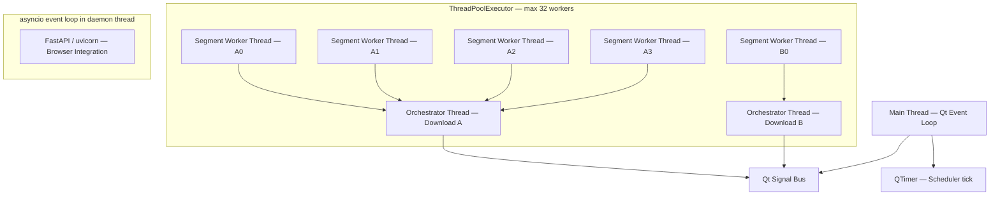
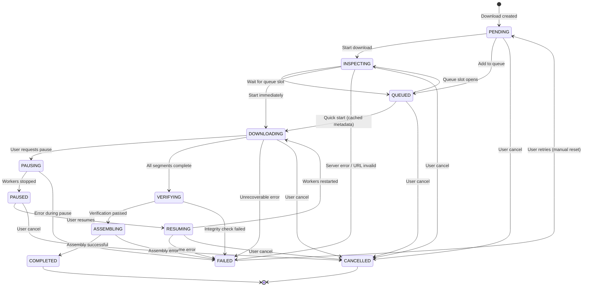
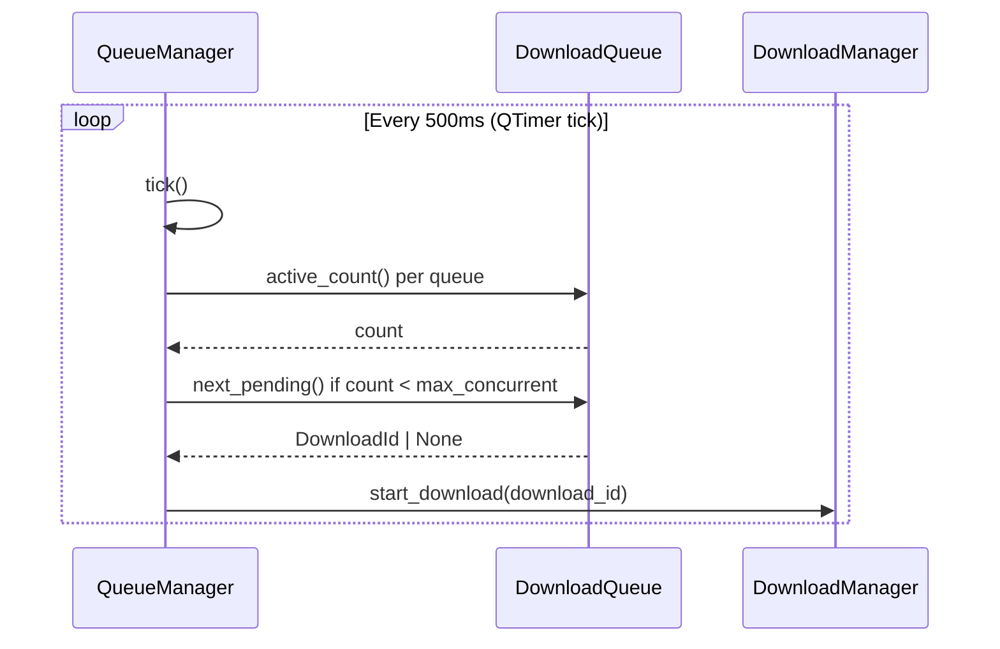

# Concurrency and State Management — PyIDM

**Document version:** 1.0  
**Status:** Draft — Stage 1  
**Date:** 2026-11-08

---

## 1. Concurrency Architecture Overview

PyIDM uses a deliberately simple concurrency model to maximize correctness and testability while delivering sufficient performance.

**Core principle:** Use Python threads (not asyncio) for the download engine, controlled through `ThreadPoolExecutor`. Use `asyncio` only for the embedded FastAPI server (browser integration).

---

## 2. Thread Architecture



**Thread budget:**
- 1 main thread (Qt event loop)
- Up to 2 concurrent downloads × up to 4 segments = ~8 worker threads active at a time (default configuration)
- Maximum global worker cap: 32 threads (configurable)
- 1 daemon thread for the asyncio event loop (FastAPI)

**Why ThreadPoolExecutor over asyncio for downloads:**
- HTTPX synchronous client is simpler for streaming with pause/cancel via threading.Event.
- Cooperative cancellation using threading.Event is straightforward and correct.
- Avoids mixing Qt's event loop with asyncio's event loop.
- Easier to debug; stack traces are more readable.
- Sufficient for the target use case (I/O-bound, 2–32 concurrent segments).

---

## 3. Qt Cross-Thread Signal Communication

The presentation layer communicates with engine threads exclusively through Qt signals.

### 3.1 Signal Adapter Pattern

A `DownloadSignalEmitter` class lives in the application layer. It implements `ProgressReporter` and translates progress callbacks into Qt signal emissions.

```
DownloadSignalEmitter (Application Layer)
  Implements: ProgressReporter
  Owns: QObject with signals

  Signals (emitted from background threads, received on main thread):
    progress_updated = Signal(str, int, int, float, float)
      — download_id, downloaded_bytes, total_bytes, speed_bps, eta_seconds
    status_changed = Signal(str, str)
      — download_id, new_status
    error_occurred = Signal(str, str)
      — download_id, error_message
    download_completed = Signal(str)
      — download_id
```

Qt guarantees that signals emitted from background threads are queued and delivered on the receiver's thread when the connection type is `Qt.ConnectionType.QueuedConnection` (which is the default for cross-thread connections).

This means no explicit Qt thread marshalling code is needed in the engine. The engine calls `reporter.report(...)`, which calls `signal.emit(...)`, and Qt handles the queuing automatically.

### 3.2 Signal Throttling

`ProgressAggregator` enforces a minimum 400ms between progress emissions. This prevents the Qt event loop from being flooded with progress updates during high-speed downloads.

For 10 simultaneous downloads at 400ms intervals, the main thread receives at most 25 progress events per second total — well within Qt's handling capacity.

---

## 4. State Machine Implementation

### 4.1 State Transition Table

| From \ To | PENDING | QUEUED | INSPECTING | DOWNLOADING | PAUSING | PAUSED | RESUMING | VERIFYING | ASSEMBLING | COMPLETED | FAILED | CANCELLED |
|-----------|---------|--------|------------|-------------|---------|--------|----------|-----------|------------|-----------|--------|-----------|
| PENDING   | —       | ✓      | ✓          | —           | —       | —      | —        | —         | —          | —         | —      | ✓         |
| QUEUED    | —       | —      | ✓          | ✓           | —       | —      | —        | —         | —          | —         | —      | ✓         |
| INSPECTING| —       | ✓      | —          | ✓           | —       | —      | —        | —         | —          | —         | ✓      | ✓         |
| DOWNLOADING| —      | —      | —          | —           | ✓       | —      | —        | ✓         | —          | —         | ✓      | ✓         |
| PAUSING   | —       | —      | —          | —           | —       | ✓      | —        | —         | —          | —         | ✓      | —         |
| PAUSED    | —       | —      | —          | —           | —       | —      | ✓        | —         | —          | —         | —      | ✓         |
| RESUMING  | —       | —      | —          | ✓           | —       | —      | —        | —         | —          | —         | ✓      | ✓         |
| VERIFYING | —       | —      | —          | —           | —       | —      | —        | —         | ✓          | —         | ✓      | —         |
| ASSEMBLING| —       | —      | —          | —           | —       | —      | —        | —         | —          | ✓         | ✓      | —         |
| COMPLETED | —       | —      | —          | —           | —       | —      | —        | —         | —          | —         | —      | —         |
| FAILED    | ✓       | —      | —          | —           | —       | —      | —        | —         | —          | —         | —      | —         |
| CANCELLED | —       | —      | —          | —           | —       | —      | —        | —         | —          | —         | —      | —         |

✓ = valid transition. — = invalid (raises InvalidTransitionError).

### 4.2 State Machine Diagram



### 4.3 Concurrency Guards

The state machine enforces exclusive ownership of state transitions.

A `DownloadStateLock` per download prevents concurrent state changes:

```python
class DownloadStateLock:
    """
    Prevents concurrent state transitions for a single download.
    One controller at a time may hold the transition lock.
    """
    _lock: threading.Lock

    def acquire_for_transition(self) -> None: ...
    def release(self) -> None: ...
```

The `DownloadManager` holds a dict of `DownloadStateLock` objects, one per active download. Any method that changes download state acquires the corresponding lock first.

---

## 5. Queue Manager Concurrency

### 5.1 Queue Concurrency Model



The queue manager does not use a dedicated thread. It runs on the main Qt thread via a `QTimer` that fires every 500ms. This keeps queue management on the main thread, avoiding additional locking complexity.

Queue operations are fast (in-memory list operations and DB reads), so running on the main thread is safe.

### 5.2 Global Download Concurrency

```
max_global_concurrent: int  — Default 3

Logic in QueueManager.tick():
  active = sum(queue.active_count() for queue in all_queues)
  if active >= max_global_concurrent:
      return  # Do not start any more downloads

  for each queue in priority order:
      available_slots = queue.max_concurrent - queue.active_count()
      global_available = max_global_concurrent - active
      slots_to_fill = min(available_slots, global_available)
      for _ in range(slots_to_fill):
          next_id = queue.next_pending()
          if next_id:
              download_manager.start_download(next_id)
              active += 1
```

---

## 6. Cancellation Pattern

Cancellation uses cooperative signaling. It is never forceful.

```
user clicks Cancel
  → ApplicationService.cancel_download(id)
    → DownloadManager.cancel_download(id)
      → orchestrator._cancel_event.set()

Each SegmentWorker, on each iteration:
  if self._cancel_event.is_set():
      return SegmentResult(cancelled=True)

Each SpeedLimiter.consume():
  While waiting (sleeping for token refill):
      if cancel_event.is_set():
          return  # Do not sleep further

DownloadOrchestrator receives CancelledResult from all workers:
  → Marks download CANCELLED
  → Cleans up temp files (per policy)
  → Removes orchestrator from DownloadManager._orchestrators
  → Reports status change
```

Maximum cancellation latency: one chunk read time (64 KB at minimum line speed).

---

## 7. Resource Management

### 7.1 Thread Pool Lifecycle

```
Application startup:
  DownloadManager._thread_pool = ThreadPoolExecutor(max_workers=global_cap)

Application shutdown:
  1. Set global cancel event.
  2. For each active orchestrator: request_cancel().
  3. thread_pool.shutdown(wait=True, cancel_futures=False)
     — Waits for currently-running workers to finish gracefully.
  4. HTTPX client pool closed.
  5. Database sessions closed.
  6. Qt application exits.
```

### 7.2 HTTP Connection Pool

The `HttpStreamClient` holds one `httpx.Client` instance with connection pooling. The pool is shared across all segment workers for a given download (each worker opens a new stream but may reuse a keepalive connection).

Connection limits:
- `max_connections=100` — Absolute maximum.
- `max_keepalive_connections=20` — Idle connections retained.
- Connections are automatically released when streams are closed.

### 7.3 File Handle Management

Each `SegmentWorker` opens its segment temp file in a `with` block. The file handle is released immediately when the segment completes, fails, or is paused.

The `FileAssembler` opens each segment file sequentially (one at a time), reads in chunks, and closes it before opening the next. This bounds the number of simultaneously open file handles to 2 (source segment + destination).

---

## 8. Scheduler Architecture

The download scheduler is a lightweight component running on the main Qt thread.

```
DownloadScheduler:
  Attributes:
    _timer: QTimer  — Fires every 60 seconds
    _queue_manager: QueueManager
    _queue_repo: QueueRepository

  On timer tick:
    1. Load all queues with schedules.
    2. For each queue:
         if schedule.should_start_now(now) and queue.status == IDLE:
             queue_manager.activate_queue(queue.id)
         if schedule.should_stop_now(now) and queue.status == RUNNING:
             queue_manager.pause_queue(queue.id)
    3. Persist any state changes.
```

The scheduler does not create threads. It delegates all activation to `QueueManager` and `DownloadManager`, which handle the thread submissions.

---

## 9. Database Thread Safety

SQLAlchemy sessions are **never shared between threads**.

Policy:
- Each repository method creates a new `Session`, performs its operation, commits or rolls back, and closes the session.
- The `sessionmaker` factory is thread-safe.
- SQLite in WAL mode allows one writer and multiple concurrent readers.
- Repository calls from worker threads are safe because they are short-lived.
- No session is held open across yield points.

```python
# Example pattern used in all repositories:
class SqlDownloadRepository:
    def __init__(self, session_factory: sessionmaker[Session]) -> None:
        self._session_factory = session_factory

    def save(self, download: Download) -> None:
        with self._session_factory() as session:
            model = DownloadModel.from_entity(download)
            session.merge(model)
            session.commit()
```

---

## 10. asyncio Integration (Browser API)

The FastAPI/uvicorn server runs in a dedicated daemon thread on its own `asyncio` event loop. It does not share the Qt event loop or the engine thread pool.

```
Main thread: Qt event loop
Daemon thread: asyncio.run(uvicorn.serve(...))
```

Communication from the browser API thread to the Qt/engine layer is routed through a thread-safe queue:

```python
# BrowserApiAdapter holds a reference to DownloadManager
# It calls download_manager.add_download(request) directly
# (DownloadManager.add_download is thread-safe via its internal lock)
```

No asyncio primitives leak into the download engine. The API layer adapter calls synchronous `DownloadManager` methods.

