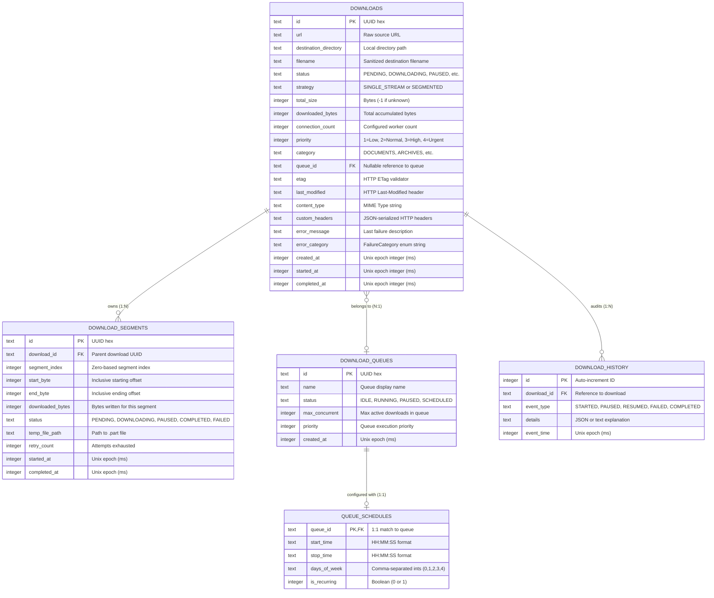

# Database and Persistence Design — PyIDM

**Document version:** 1.0  
**Status:** Complete — Stage 1  
**Date:** 2026-11-08  
**Author:** Software Architecture Team

---

## 1. Relational Persistence Overview

PyIDM uses **SQLite** as its local datastore, operated through **SQLAlchemy 2.0** declarative mapping and **Alembic** for schema migrations.

### 1.1 Architectural Rules for Persistence
1. **Thread Isolation**: SQLite connections are never shared across threads. We use `scoped_session` with `NullPool` so that worker threads and the main UI thread obtain isolated thread-local connections.
2. **High-Frequency State in RAM**: In-flight byte counters and instantaneous speed are kept in memory and throttled in `ProgressAggregator`. They are written to SQLite only on state transitions (pause, complete, fail, restart).
3. **WAL Concurrency**: Write-Ahead Logging allows simultaneous non-blocking reads while background workers write download metadata.
4. **Relational Integrity**: Foreign keys are explicitly enabled (`PRAGMA foreign_keys = ON`), ensuring cascade deletes cleanly purge orphaned segments when a download record is deleted.

---

## 2. Entity-Relationship Diagram



---

## 3. Database Schema Definitions (SQLAlchemy 2.0 Declarative)

```python
from datetime import datetime
from typing import Optional
from sqlalchemy import (
    BigInteger,
    CheckConstraint,
    ForeignKey,
    Index,
    Integer,
    String,
    Text,
    text,
)
from sqlalchemy.orm import DeclarativeBase, Mapped, mapped_column, relationship

class Base(DeclarativeBase):
    pass

class DownloadModel(Base):
    __tablename__ = "downloads"

    id: Mapped[str] = mapped_column(String(36), primary_key=True)
    url: Mapped[str] = mapped_column(Text, nullable=False)
    destination_directory: Mapped[str] = mapped_column(Text, nullable=False)
    filename: Mapped[str] = mapped_column(String(255), nullable=False)
    status: Mapped[str] = mapped_column(String(32), nullable=False, default="PENDING")
    strategy: Mapped[Optional[str]] = mapped_column(String(32), nullable=True)
    total_size: Mapped[int] = mapped_column(BigInteger, default=-1)
    downloaded_bytes: Mapped[int] = mapped_column(BigInteger, default=0)
    connection_count: Mapped[int] = mapped_column(Integer, default=4)
    priority: Mapped[int] = mapped_column(Integer, default=2)
    category: Mapped[str] = mapped_column(String(64), default="OTHER")
    queue_id: Mapped[Optional[str]] = mapped_column(
        String(36), ForeignKey("download_queues.id", ondelete="SET NULL"), nullable=True
    )
    etag: Mapped[Optional[str]] = mapped_column(String(255), nullable=True)
    last_modified: Mapped[Optional[str]] = mapped_column(String(255), nullable=True)
    content_type: Mapped[Optional[str]] = mapped_column(String(128), nullable=True)
    custom_headers: Mapped[Optional[str]] = mapped_column(Text, nullable=True)  # JSON
    error_message: Mapped[Optional[str]] = mapped_column(Text, nullable=True)
    error_category: Mapped[Optional[str]] = mapped_column(String(64), nullable=True)
    created_at: Mapped[int] = mapped_column(BigInteger, nullable=False)
    started_at: Mapped[Optional[int]] = mapped_column(BigInteger, nullable=True)
    completed_at: Mapped[Optional[int]] = mapped_column(BigInteger, nullable=True)

    segments: Mapped[list["DownloadSegmentModel"]] = relationship(
        "DownloadSegmentModel", back_populates="download", cascade="all, delete-orphan"
    )

    __table_args__ = (
        Index("ix_downloads_status", "status"),
        Index("ix_downloads_created_at", "created_at"),
        Index("ix_downloads_category", "category"),
        Index(
            "ix_active_downloads",
            "status",
            sqlite_where=text("status IN ('DOWNLOADING', 'QUEUED', 'INSPECTING')"),
        ),
    )

class DownloadSegmentModel(Base):
    __tablename__ = "download_segments"

    id: Mapped[str] = mapped_column(String(36), primary_key=True)
    download_id: Mapped[str] = mapped_column(
        String(36), ForeignKey("downloads.id", ondelete="CASCADE"), nullable=False
    )
    segment_index: Mapped[int] = mapped_column(Integer, nullable=False)
    start_byte: Mapped[int] = mapped_column(BigInteger, nullable=False)
    end_byte: Mapped[int] = mapped_column(BigInteger, nullable=False)
    downloaded_bytes: Mapped[int] = mapped_column(BigInteger, default=0)
    status: Mapped[str] = mapped_column(String(32), default="PENDING")
    temp_file_path: Mapped[Optional[str]] = mapped_column(Text, nullable=True)
    retry_count: Mapped[int] = mapped_column(Integer, default=0)
    started_at: Mapped[Optional[int]] = mapped_column(BigInteger, nullable=True)
    completed_at: Mapped[Optional[int]] = mapped_column(BigInteger, nullable=True)

    download: Mapped["DownloadModel"] = relationship("DownloadModel", back_populates="segments")

    __table_args__ = (
        Index("ix_segments_download_id", "download_id"),
        CheckConstraint("start_byte <= end_byte", name="ck_segment_byte_order"),
    )
```

---

## 4. SQLite Optimization & PRAGMAs

On every SQLite connection establishment, PyIDM applies tuned PRAGMAs via SQLAlchemy event hooks:

```python
from sqlalchemy import event, Engine

def configure_sqlite_pragmas(db_engine: Engine) -> None:
    @event.listens_for(db_engine, "connect")
    def set_pragmas(dbapi_connection, connection_record):
        cursor = dbapi_connection.cursor()
        cursor.execute("PRAGMA journal_mode = WAL;")
        cursor.execute("PRAGMA synchronous = NORMAL;")
        cursor.execute("PRAGMA busy_timeout = 5000;")
        cursor.execute("PRAGMA foreign_keys = ON;")
        cursor.execute("PRAGMA cache_size = -65536;")  # 64 MB RAM cache
        cursor.execute("PRAGMA mmap_size = 268435456;") # 256 MB memory-mapped I/O
        cursor.execute("PRAGMA temp_store = MEMORY;")
        cursor.close()
```

### Shutdown Maintenance
On application exit, PyIDM issues:
```sql
PRAGMA optimize;
PRAGMA wal_checkpoint(TRUNCATE);
```
This truncates `.db-wal` and `.db-shm` files so that only a clean, unified `pyidm.db` file remains on disk.

---

## 5. Repository Pattern & Transaction Strategy

All domain repositories adhere to strict Protocols. A repository method opens a session from `scoped_session`, performs atomic unit-of-work, and commits immediately:

```python
class SqlDownloadRepository:
    def __init__(self, session_factory: sessionmaker[Session]) -> None:
        self._session_factory = session_factory

    def save(self, download: Download) -> None:
        with self._session_factory() as session:
            model = DownloadModelMapper.to_model(download)
            session.merge(model)
            session.commit()

    def get_by_id(self, download_id: DownloadId) -> Download | None:
        with self._session_factory() as session:
            model = session.get(DownloadModel, str(download_id))
            if model is None:
                return None
            return DownloadModelMapper.to_entity(model)
```

### Inconsistency Prevention with File System
If SQLite marks a download as `COMPLETED`, but the target file is missing or corrupted on disk, startup recovery detects the discrepancy, resets the record to `FAILED`, and logs the error, ensuring the database never lies about file state.

