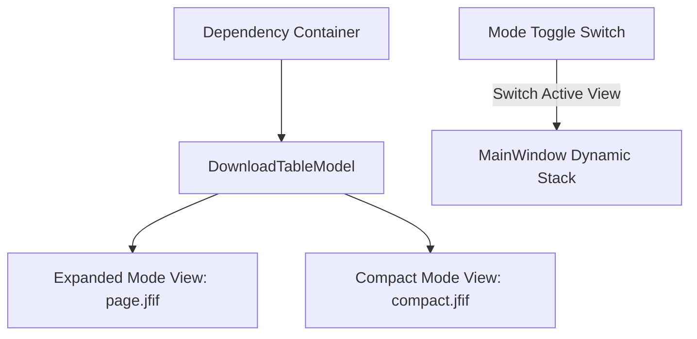

# UI Design and Presentation Specification — PyIDM

**Document version:** 2.0  
**Status:** Complete — Stage 1  
**Date:** 2026-11-08  
**Author:** Software Architecture Team  
**Visual References:** `pics/page.jfif` (Modern Dark Full Interface), `pics/compact.jfif` (Compact Mode Interface), and `pics/page-1.jfif` (Classic IDM Interface).

---

## 1. Visual Direction and Dual-Mode UI Architecture

PyIDM is built with **PySide6 (Qt 6)** and provides a responsive, high-performance desktop interface. It implements a **Dual-Mode UI Architecture** allowing the user to seamlessly switch between:
1. **Expanded Mode** (Full Dashboard based on `pics/page.jfif` and `pics/page-1.jfif`): A feature-rich command center with sidebar navigation, categorization trees, queue management, search bar, sort controls, and diagnostic statistics.
2. **Compact Mode** (Minimalist High-Density View based on `pics/compact.jfif`): A streamlined, low-footprint window with an icon-only slim sidebar, compact toolbar, and dense download table designed to remain unobtrusive on the user's workspace.

### 1.1 Shared State Architecture
Both modes operate on the **exact same underlying application state**:
- Shared `Container` and backend services (`DownloadManager`, `QueueManager`, `RecoveryManager`).
- Shared `DownloadTableModel` (`QAbstractTableModel`) with continuous real-time signal propagation.
- Mode toggling is instant (via a header toggle switch in Expanded Mode and a sidebar icon in Compact Mode) and persists across application restarts in user preferences.



---

## 2. Expanded Mode Specification (`pics/page.jfif` & `pics/page-1.jfif`)

### 2.1 Visual Layout Diagram

```text
+----------------------------------------------------------------------------------------------------+
| [PyIDM Profile]  [+ New]  [▶ Play]  [⏸ Pause]  [🗑 Delete]  [⊞ Grid]  [⇅ Sort]  [?]  [● Compact]  [🔍 Search...] |
+-------------------+--------------------------------------------------------------------------------+
| DOWNLOADS         | DOWNLOAD DASHBOARD                                                             |
| ◉ All Tasks (8)   +--------------------------------------------------------------------------------+
| ⬇ Downloading (3) | ☑ | File Name       | Size     | Progress Bar               | Time Left| Speed    | > |
| ⏳ Waiting (1)     |---|-----------------+----------+----------------------------+----------+----------+---|
| ✔ Finished (4)    | ☑ | Moive.2018.mkv  | 108.5 MB | [=====>              ] 2%  | 00:00:00 | 0.00 B/s | > |
|                   | ☐ | ubuntu-24.iso   | 5.8 GB   | [====================] 100%| --       | --       | > |
| SETTINGS          | ☐ | setup.exe       | 84.5 MB  | [====================] 100%| --       | --       | > |
| ⚙ General Settings| ☐ | document.pdf    | 2.1 MB   | [========!           ] 40% | Error (3)| --       | > |
| ⚡ Engine Settings |   |                 |          |                            |          |          |   |
| 🟢 Engine Active  |   |                 |          |                            |          |          |   |
|                   |   |                 |          |                            |          |          |   |
| CATEGORIES        |   |                 |          |                            |          |          |   |
| 📁 Documents      |   |                 |          |                            |          |          |   |
| 📦 Archives       |   |                 |          |                            |          |          |   |
| 🎬 Video / Audio  |   |                 |          |                            |          |          |   |
+-------------------+---+-----------------+----------+----------------------------+----------+----------+---+
| ☰ Menu  |  ⌨ Shortcuts                                                    ↓ 0.00 B/s  ↑ 0.00 B/s    |
+----------------------------------------------------------------------------------------------------+
```

### 2.2 Component Breakdown (Expanded Mode)

1. **Header Action Bar**:
   - **Profile / Context Selector**: Dropdown to select active download profile or connection profile.
   - **Primary Action Buttons**:
     - `+ New`: Opens `AddDownloadDialog`.
     - `▶ Play / Resume`: Starts or resumes selected downloads.
     - `⏸ Pause`: Pauses selected active downloads cooperatively.
     - `🗑 Delete`: Opens confirmation dialog to delete record and/or file.
     - `⊞ Multi-select / View Toggle`: Switches selection mode.
     - `⇅ Sort`: Sorts table by Name, Size, Progress, Date, or Speed.
     - `? Help`: Displays documentation and version information.
   - **Compact Mode Switch**: Styled `QSwitch` / toggle button to switch to Compact Mode instantly.
   - **Search Input**: Live filtering of the table model by filename or URL.

2. **Left Navigation Sidebar**:
   - **Download Status Groups**:
     - `All Tasks` (with count badge).
     - `Downloading` (with active count badge).
     - `Waiting / Queued` (with pending count badge).
     - `Finished / Stopped` (with completed count badge).
   - **Settings Group**:
     - `General Settings`: Opens global configuration.
     - `Engine Settings`: Configures connections, buffers, timeouts.
     - `Engine Status Badge`: Visual green pill indicating backend engine status.
   - **Category Tree** (IDM Classic Hierarchy from `pics/page-1.jfif`):
     - `Compressed` / `Documents` / `Music` / `Programs` / `Video` / `Other`.

3. **Download Table View**:
   - **Columns**: Multi-select Checkbox, File Name (with file icon), File Size, Graphical Progress Bar, Time Left / ETA, Download Speed, Details Chevron (`>`).
   - **Rich Context Menu** (matching `pics/page.jfif`):
     - `⏸ Pause` / `▶ Resume`
     - `🗑 Delete`
     - `⇅ Display Order` (Move Up / Move Down / Move to Top)
     - `☑ Select Failed Tasks`
     - `☑ Select Completed Tasks`
     - `⊞ Select All`
     - `🔗 Copy Download Link`
     - `📁 Open Containing Folder`
     - `📄 Open File`

4. **Footer Status Bar**:
   - Quick menu trigger (`☰`) and Keyboard Shortcuts reference (`⌨ Shortcuts`).
   - Aggregate network throughput indicator (`↓ 0.00 B/s  ↑ 0.00 B/s`).

---

## 3. Compact Mode Specification (`pics/compact.jfif`)

### 3.1 Visual Layout Diagram

```text
+----------------------------------------------------------------------------------------------------+
| [Logo]  [+ Add URL]  [⬇ Download]  [⏹ Stop]  [🗑 Remove]  [➕ Add To Queue]  [🔄 Check Update]  [🧩 Get Extension] |
+-----+----------------------------------------------------------------------------------------------+
| ⬇   | File Name               | Size      | Progress | Status  | Transfer Rate | Time Left | Start Date |
| 📋  |-------------------------+-----------+----------+---------+---------------+-----------+------------|
| ✔   | ☑ Wind.Breaker.mkv      | 203.14 MB | 71.38%   | Paused  | --            | --        | 2026-11-08 |
| ➕  | ☐ Kaguya.sama.ep01.mkv  | 464.30 MB | 0.00%    | Queued  | --            | --        | 2026-11-08 |
|     | ☐ Kaguya.sama.ep02.mkv  | 461.90 MB | 0.00%    | Queued  | --            | --        | 2026-11-08 |
|     | ☐ Kaguya.sama.ep03.mkv  | 341.72 MB | 0.00%    | Queued  | --            | --        | 2026-11-08 |
| ⚙   |                         |           |          |         |               |           |            |
+-----+-------------------------+-----------+----------+---------+---------------+-----------+------------+
```

### 3.2 Component Breakdown (Compact Mode)

1. **Slim Vertical Icon Sidebar**:
   - `⬇ Downloads`: Filters table to active/all tasks.
   - `📋 Queues / Clipboard`: Displays queue view or clipboard history.
   - `✔ Completed`: Filters table to finished downloads.
   - `➕ Add`: Quick add URL.
   - `⚙ Settings`: Quick trigger for settings dialog at bottom left.

2. **Compact Horizontal Action Toolbar**:
   - `+ Add URL`: Green icon quick trigger.
   - `⬇ Download`: Start/Resume selected items.
   - `⏹ Stop`: Stop/Pause selected items.
   - `🗑 Remove`: Red trash icon deletion.
   - `➕ Add To Queue`: Assigns selected downloads to a designated queue.
   - `🔄 Check for Update`: Checks for application updates.
   - `🧩 Get Extension`: Opens instructions or store page for Chrome/Firefox extension.

3. **High-Density Table View**:
   - Space-optimized table columns: Checkbox + Icon + File Name, Size, Progress %, Status, Transfer Rate, Time Left, Start Date.

---

## 4. Custom Qt Delegates & Theming

### 4.1 Segmented Progress Bar Item Delegate (`SegmentedProgressBarDelegate`)
A custom `QStyledItemDelegate` subclass paints multi-segment progress directly within table cells:
- **Active Segment Stripes**: Draws the contiguous byte-range slices with clear separation.
- **Color-Coded Statuses**:
  - `#3b82f6` (Vibrant Blue) for actively streaming segments.
  - `#10b981` (Emerald Green) for 100% completed downloads.
  - `#f59e0b` (Amber Orange) for paused downloads or transient retry states.
  - `#ef4444` (Coral Red) for failed downloads.
- **Hardware-Accelerated Painting**: Implemented using pure `QPainter` drawing calls in `paint()` without creating child `QWidget` instances, ensuring fluid 60 FPS scrolling over thousands of rows.

### 4.2 Modern Dark Theme (`dark.qss`)
Styled according to the dark palette in `pics/page.jfif` and `pics/compact.jfif`:
- Background primary: `#18181b` (Zinc-900).
- Surface secondary: `#27272a` (Zinc-800).
- Selection accent: `#2563eb` (Blue-600) / `#3b82f6` (Blue-500).
- Typography: Segoe UI (Windows), Inter / Ubuntu (Linux), -apple-system (macOS).
- Clean borders, modern hover transitions, and rounded badges for counts.

---

## 5. Modal Dialogs

### 5.1 Add Download Dialog (`AddDownloadDialog`)
- **Auto-Paste**: Reads clipboard upon display; if a valid HTTP/HTTPS URL is found, it pre-fills the input.
- **Asynchronous Inspection**: Initiates a non-blocking `inspect()` probe to resolve true filename, Content-Length, and Range capabilities before downloading begins.
- **Destination & Connection Tuning**: Allows selecting target folder and connection count (1–32).

### 5.2 Download Details Dialog (`DownloadDetailsDialog`)
- **General Tab**: Original URL, resolved redirect URL, file path, size, MD5/SHA-256 checksums, creation/completion dates.
- **Segments Tab**: Visual graphical strip displaying each segment's byte window, downloaded percentage, assigned worker thread, and current download speed.
- **Log / Diagnostics Tab**: Recorded network events, HTTP status codes, redirect hops, and retry backoff logs.

### 5.3 Settings Dialog (`SettingsDialog`)
- **General**: Download folder, auto-start, clipboard monitoring toggle.
- **Engine**: Max concurrent downloads (1–10), default connections per download (1–32), chunk buffer size, speed limit.
- **Browser Integration**: API loopback port, token regeneration, extension installation helper.
- **Appearance**: Theme selection (Dark / Light / System), Default View Mode (Expanded / Compact).
