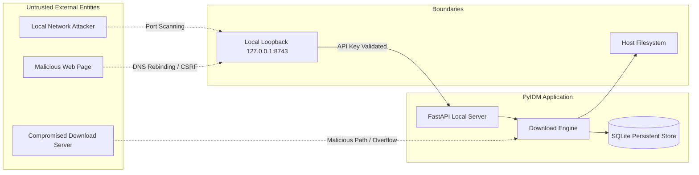

# Security Architecture and Threat Model — PyIDM

**Document version:** 1.0  
**Status:** Complete — Stage 1  
**Date:** 2026-11-08  
**Author:** Software Architecture Team

---

## 1. Threat Modeling Overview

As a desktop application with network access, local filesystem write capabilities, and an embedded HTTP server for browser extensions, PyIDM presents several potential attack vectors that must be proactively mitigated.



---

## 2. Threat Vector Analysis & Mitigation Matrix

| Vector ID | Threat Description | Attack Scenario | Architectural Mitigation |
|---|---|---|---|
| **THR-01** | **DNS Rebinding & Host Header Attack** | An attacker tricks the browser into routing requests from `malicious.com` to `127.0.0.1:8743` to issue download commands. | The FastAPI server strictly inspects the HTTP `Host` header. Any request where `Host` is not `127.0.0.1:<port>` or `localhost:<port>` is immediately dropped with `400 Bad Request`. |
| **THR-02** | **Unauthorized Local API Access** | Another local non-privileged user or malware tries to query or control PyIDM through the local API. | PyIDM generates a cryptographically random 256-bit API token on first run, stored in user-only readable configuration (`chmod 600` / Windows ACL). All extension requests must supply this token via `X-PyIDM-Key`. |
| **THR-03** | **SSRF / Internal Network Probing** | A malicious extension payload or link directs PyIDM to download from cloud metadata services (`169.254.169.254`) or internal routers (`192.168.1.1`). | Requests received via browser extension or clipboard are validated. RFC 1918 private IP ranges, link-local addresses, and loopback IP targets are explicitly blocked unless the user overrides with an explicit confirmation dialog. |
| **THR-04** | **Arbitrary File Overwrite / Path Traversal** | The server provides a malicious `Content-Disposition` header such as `filename=../../../../Windows/System32/calc.exe`. | `FilenameResolver` strips all path components (`/`, `\`, `..`), normalizes illegal OS characters, and truncates the filename to 255 bytes. The target directory is strictly validated to ensure the resulting path remains within the user's selected destination folder. |
| **THR-05** | **Sensitive Credential Exposure** | Passwords, Basic Auth headers, or session cookies are recorded in diagnostic logs. | The logging subsystem applies a redaction filter that strips values for `Authorization`, `Cookie`, `Set-Cookie`, `Proxy-Authorization`, and `X-PyIDM-Key` before writing to file or console. |
| **THR-06** | **Scheme Injection & Protocol Exploitation** | A malicious URL contains `file:///`, `smb://`, `gopher://`, or executable scripts (`javascript:`). | The URL validator strictly allows only `http://` and `https://` schemes. All other protocols raise `InvalidUrlError`. |
| **THR-07** | **Disk Exhaustion Denial of Service** | An attacker provides a URL with a fake multi-terabyte Content-Length or an infinite gzip compression bomb. | The engine performs disk space checks against destination drive capacity prior to allocation. In streaming decompression, a ratio threshold halts downloads that exceed safe limits. |
| **THR-08** | **Cross-Origin Resource Sharing (CORS) Bypass** | Browser scripts make unauthorized background `fetch()` calls to the PyIDM loopback API. | Strict CORS middleware is applied. Only origins matching `chrome-extension://<id>` and `moz-extension://<id>` for registered PyIDM extension IDs are permitted. All `*` wildcards are prohibited. |

---

## 3. Local API Security Implementation Architecture

```python
# app/infrastructure/browser/security.py
import secrets
from fastapi import Request, HTTPException, Security
from fastapi.security import APIKeyHeader

API_KEY_NAME = "X-PyIDM-Key"
api_key_header = APIKeyHeader(name=API_KEY_NAME, auto_error=False)

class SecurityValidator:
    def __init__(self, expected_token: str, allowed_port: int) -> None:
        self._expected_token = expected_token
        self._allowed_host = f"127.0.0.1:{allowed_port}"
        self._allowed_localhost = f"localhost:{allowed_port}"

    async def validate_request(self, request: Request, api_key: str | None = Security(api_key_header)) -> None:
        # 1. Host Header Validation (Anti-DNS Rebinding)
        host = request.headers.get("host")
        if host not in (self._allowed_host, self._allowed_localhost):
            raise HTTPException(status_code=400, detail="Invalid Host header")

        # 2. Token Authentication
        if not api_key or not secrets.compare_digest(api_key, self._expected_token):
            raise HTTPException(status_code=401, detail="Unauthorized: Invalid or missing API key")

        # 3. Origin Verification for CORS
        origin = request.headers.get("origin")
        if origin and not (origin.startswith("chrome-extension://") or origin.startswith("moz-extension://")):
            raise HTTPException(status_code=403, detail="Forbidden origin")
```

---

## 4. Temporary File Protection & Permissions

1. **Isolation**: Temporary chunks are stored under `<download_dir>/.pyidm_temp/<download_uuid>/`.
2. **Permissions**: Temporary directories on POSIX systems are created with `0o700` (read/write/execute for user only).
3. **Atomic Finalization**: Part files are assembled into a hidden `.assembling` file, verified, and renamed to the target filename via atomic `os.replace()`, preventing half-written or corrupt files from ever being exposed as valid downloads.

