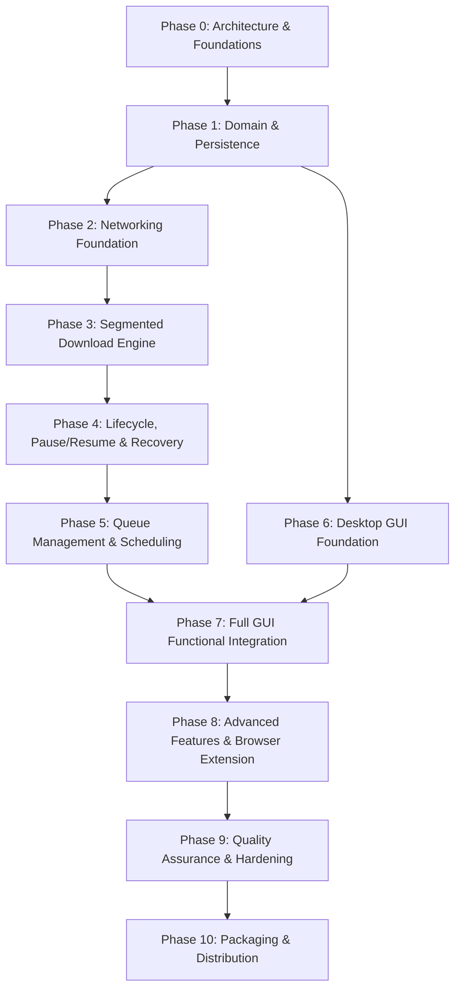

# Implementation Roadmap and Phase Specifications — PyIDM

**Document version:** 1.0  
**Status:** Complete — Stage 1  
**Date:** 2026-11-08  
**Author:** Software Architecture Team

---

## 1. Roadmap Overview and Phase Dependencies

The implementation plan is structured into 11 strictly sequenced phases. Each phase establishes prerequisites, concrete deliverables, acceptance criteria, and quality gates.

---

## 2. Detailed Phase Specifications

### Phase 0: Architecture and Project Foundations
- **Prerequisites**: Approved Stage 1 implementation plan.
- **Objectives**: Initialize repository configuration, toolchains, strict static typing, and core protocols.
- **Tasks**:
  1. Generate `pyproject.toml` with `uv` configurations for Ruff, mypy, and pytest.
  2. Configure `mypy` strict mode (explicitly disallow `Any`, require type annotations everywhere).
  3. Establish `app/shared/` primitives (`constants.py`, `types.py`, `protocols.py`).
  4. Create base testing fixtures in `tests/conftest.py`.
- **Exit Criteria**: `uv sync`, `ruff check .`, and `mypy .` run cleanly with zero errors.

---

### Phase 1: Domain Models and Persistence Layer
- **Prerequisites**: Phase 0.
- **Objectives**: Implement pure domain business logic, entities, value objects, and SQLite/SQLAlchemy 2.0 repository persistence.
- **Tasks**:
  1. Implement all domain value objects (`ByteRange`, `DownloadUrl`, `DownloadSpeed`, `FileSize`).
  2. Implement `Download` and `DownloadSegment` entities with strict state transition validation.
  3. Create SQLAlchemy 2.0 declarative models (`DownloadModel`, `DownloadSegmentModel`, `DownloadQueueModel`).
  4. Configure SQLite connection engine with WAL mode and PRAGMA tuning.
  5. Setup Alembic migrations with `render_as_batch=True`.
  6. Implement concrete repositories (`SqlDownloadRepository`, `SqlSegmentRepository`).
  7. Write unit tests for domain entities and integration tests for persistence.
- **Exit Criteria**: 100% test pass rate on domain state transitions and SQLite CRUD operations.

---

### Phase 2: Networking Foundation
- **Prerequisites**: Phase 1.
- **Objectives**: Build the HTTP client wrapper, resource inspection engine, and single-stream streaming downloader.
- **Tasks**:
  1. Implement `HttpStreamClient` wrapping `httpx.Client` with connection pooling, timeouts, and redirects.
  2. Implement `ResourceInspectorImpl` with HEAD request logic and ranged GET fallback (`Range: bytes=0-0`).
  3. Implement `FilenameResolver` with `Content-Disposition` parsing and path traversal sanitization.
  4. Implement single-stream download worker with chunked streaming to disk.
  5. Build the mock HTTP test server fixture capable of simulating range support, errors, and chunk streaming.
- **Exit Criteria**: Single-stream downloads execute successfully from the mock server; Content-Disposition filenames are extracted accurately.

---

### Phase 3: Segmented Download Engine
- **Prerequisites**: Phase 2.
- **Objectives**: Implement multi-threaded byte-range downloading, worker pools, progress tracking, and atomic file assembly.
- **Tasks**:
  1. Implement `SegmentCalculator` to partition files into contiguous, non-overlapping `ByteRange` slices.
  2. Implement `SegmentWorker` streaming chunks to isolated `.pyidm_temp/<id>/segment_XXX.part` files.
  3. Implement `WorkerPool` managing concurrent execution via `ThreadPoolExecutor`.
  4. Implement `ProgressAggregator` and `RollingSpeedMeter` using monotonic timestamps and throttled reporting.
  5. Implement `FileAssembler` performing sequential block copy from part files into the verified target file.
  6. Write integration tests verifying 4-segment and 8-segment parallel downloads with SHA-256 integrity verification.
- **Exit Criteria**: Parallel downloads produce bit-perfect files verified against source hashes.

---

### Phase 4: Download Lifecycle, Pause/Resume & Crash Recovery
- **Prerequisites**: Phase 3.
- **Objectives**: Implement robust pause/resume mechanics, cooperative cancellation, retry with exponential backoff, and startup crash recovery.
- **Tasks**:
  1. Implement `DownloadOrchestrator` coordinating inspection, planning, downloading, and assembly.
  2. Implement cooperative pause via `threading.Event`, segment state persistence, and `If-Range` resume logic.
  3. Implement `RetryCoordinator` with error classification and exponential backoff with jitter.
  4. Implement `JsonManifestStorage` writing `.pyidm_temp/<id>/manifest.json`.
  5. Implement `RecoveryManager` reconciling SQLite state with filesystem manifests upon startup.
  6. Write tests simulating abrupt download interruption and successful resumption from partial bytes.
- **Exit Criteria**: Paused downloads resume without re-downloading existing bytes; startup recovery restores interrupted tasks.

---

### Phase 5: Download Management, Queuing & Scheduling
- **Prerequisites**: Phase 4.
- **Objectives**: Implement high-level download scheduling, concurrency limits, queues, and bandwidth limiting.
- **Tasks**:
  1. Implement `DownloadManager` controlling global worker limits and active orchestrators.
  2. Implement `QueueManager` with priority handling and per-queue concurrency caps.
  3. Implement `DownloadScheduler` for time-based queue starts and stops.
  4. Implement `TokenBucket` bandwidth limiter and wire it to chunk writes.
  5. Write tests verifying queue ordering, concurrency caps, and bandwidth throttling adherence.
- **Exit Criteria**: Queue concurrency limits are strictly enforced; speed throttling maintains target bandwidth limits within ±5%.

---

### Phase 6: Desktop GUI Foundation (PySide6)
- **Prerequisites**: Phase 1.
- **Objectives**: Construct the modern PySide6 desktop interface shell, navigation, themes, and Model/View infrastructure.
- **Tasks**:
  1. Implement `QApplication` lifecycle and main window shell (`MainWindow`).
  2. Implement `DownloadTableModel` subclassing `QAbstractTableModel`.
  3. Implement custom `ProgressBarDelegate` and `StatusBadgeDelegate`.
  4. Implement navigation sidebar (status filters, categories, queues).
  5. Implement QSS theme engine (`light.qss`, `dark.qss`) with OS theme detection.
  6. Build headless GUI test suite with `pytest-qt`.
- **Exit Criteria**: GUI launches headlessly in CI (`QT_QPA_PLATFORM=offscreen`); table model updates render cleanly.

---

### Phase 7: Full GUI Functional Integration
- **Prerequisites**: Phase 5, Phase 6.
- **Objectives**: Wire the PySide6 presentation layer to the application services, engine events, and dialogs.
- **Tasks**:
  1. Connect `DownloadSignalEmitter` to Qt main thread signal slots for live progress and speed updates.
  2. Implement `AddDownloadDialog` with URL auto-paste, background inspection, and validation.
  3. Implement `DownloadDetailsDialog` with segment visualization and diagnostic logs.
  4. Connect table context menus (Start, Pause, Resume, Cancel, Delete, Open File, Open Folder).
  5. Implement `SettingsDialog` managing app configuration via `pydantic-settings`.
  6. Connect system tray icon and OS desktop notifications.
- **Exit Criteria**: All UI buttons, dialogs, and context menu items are fully functional with real backend execution.

---

### Phase 8: Advanced Features & Browser Extension
- **Prerequisites**: Phase 7.
- **Objectives**: Implement browser integration (FastAPI loopback server + Chrome/Firefox WebExtension), clipboard monitor, and file categorization.
- **Tasks**:
  1. Implement embedded FastAPI server on `127.0.0.1:8743` in a dedicated background daemon thread.
  2. Implement Host header validation, CORS restriction, and `X-PyIDM-Key` token authentication.
  3. Create Chrome Manifest V3 and Firefox WebExtension packages with context menus and link interception.
  4. Implement `ClipboardMonitor` watching for downloadable URLs with non-intrusive notification prompts.
  5. Implement automatic MIME/extension classification into categories.
- **Exit Criteria**: Browser extension captures links and enqueues downloads in PyIDM via authenticated loopback API.

---

### Phase 9: Quality Assurance & Hardening
- **Prerequisites**: Phase 8.
- **Objectives**: Execute full automated test suites, concurrency stress tests, security review, and memory profiling.
- **Tasks**:
  1. Run comprehensive integration test suite with mock network latency and dropped connections.
  2. Perform concurrency stress tests (rapid pause/resume cycles, 20 parallel downloads).
  3. Verify memory consumption remains bounded during 50GB file download simulations.
  4. Complete full static analysis: zero `mypy --strict` errors, zero Ruff violations.
  5. Verify sensitive header redaction across all log files.
- **Exit Criteria**: 100% test suite pass rate; code coverage ≥ 80% on engine/domain; zero unexplained type warnings.

---

### Phase 10: Packaging and Distribution
- **Prerequisites**: Phase 9.
- **Objectives**: Produce standalone desktop distributions for Windows and Linux without requiring Python pre-installation.
- **Tasks**:
  1. Create PyInstaller `.spec` configuration bundling PySide6 plugins and Alembic assets.
  2. Test standalone directory (`onedir`) build on Windows 10/11 and Linux (Ubuntu 22.04).
  3. Create Windows installer setup script (Inno Setup).
  4. Write comprehensive User Manual, Setup Guide, and Developer Architecture documentation.
- **Exit Criteria**: Standalone executable launches cleanly on fresh OS environments without Python installed.

